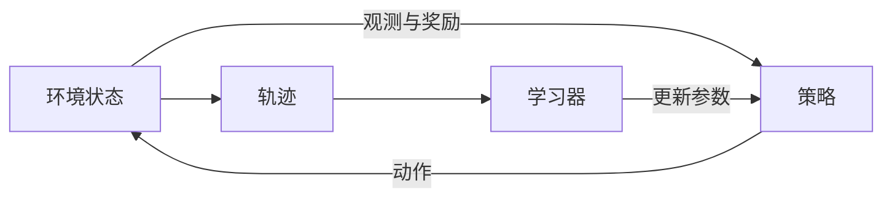
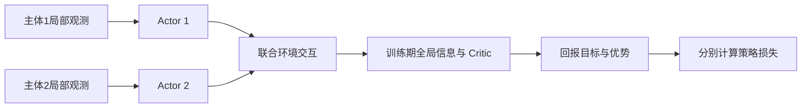

# 现代强化学习指南

> 从核心原理到大模型与多智能体实践  
> 更新日期：2026-11-17  
> 面向具备机器学习基础的开发者、研究人员与技术负责人。

[分章目录与阅读路线](README.md)。全书共8篇31章与6类附录，章末配有思考题及参考思路。文中实验为设计方案，教学数值不代表训练结果。

<a id="introduction"></a>

## 导读：让智能体从反馈中学会决策与协作

助手写出了一段 SQL。语法正确，数据库也顺利返回了结果，但用户看了一眼说：“我要的是上季度，你查的是最近三个月。”问题出在哪里？它会写查询，却没有在行动前弄清任务，也没有在交付前核对口径。

把事情做好，需要一连串恰当的选择：先查什么，遇到错误怎样调整，什么时候继续，什么时候停止。强化学习（Reinforcement Learning，RL）研究如何利用行动及其反馈，逐渐学会这些选择。

我们把选择动作的方式称为策略。智能体按策略行动，环境随之变化并返回反馈；学习算法再用这些经历更新策略。监督学习可以示范“这一步应该怎么做”，奖励则评价“这样做的结果有多好”。实践中，先模仿好做法、再从反馈中改进，是可以组合的一条路径。

困难在于，好结果常常由早先一个不起眼的动作促成。一次字段核查没有直接给出答案，却避免了后续多次报错；一次匆忙提交省了时间，却留下错误。学习需要回头判断哪些动作有帮助，这就是信用分配。它还需要尝试新选择，否则永远看不到熟悉路径之外的机会。

大模型把这些问题带到了更丰富的任务中。模型可以根据偏好或测试结果改进回答；Agent 可以学习工具调用、恢复与求助；多个智能体则进一步学习分工、通信与对抗。贯穿其中的问题始终相似：我们在学习什么，凭什么判断好坏，又怎样知道进步可以迁移到新任务？

这本指南沿着这些问题展开。前4章建立概念与算法地图，随后进入大模型、Agent 和多智能体，再连接数据、约束、工程与银行案例。公式只在能帮助理解时出现，每个方法都尽量说明机制、条件和失败方式。

### 如何使用这本指南

第一次阅读，可以按章往前走。已有基础的读者可按[专题路线](README.md)选读，再用各章的“读前回顾”补齐概念。先跟着例子理解动作和反馈，再看公式中每个量从哪里来；读到章末，停下来想一想，再展开参考思路。

读完后，希望你面对一个新任务时，能说清三件事：**值得学习的是哪个决策，可靠反馈来自哪里，以及什么证据能证明系统做得更好。**

## 第一篇：强化学习的核心原理

<a id="chapter-01"></a>

### 第01章 强化学习解决什么问题

用户说：“帮我统计这类客户上季度的交易。”助手很快写出 SQL，却收到一条报错。接下来，是改语句、查表结构，还是先问清统计口径？答案能否做对，往往取决于这些看似不起眼的选择。

强化学习关心的，就是怎样从行动的结果中学会更好的选择。它把一连串决策放在一起，评价它们最终带来了什么。

#### 1.1 从“给出答案”到“选择行动”

把这一过程展开，助手每做一次选择，就会得到新信息，也会消耗时间和预算。前一步的后果改变了后一步的处境，这就是**序列决策**。

强化学习把选择动作的方式称为**策略**。策略既可以是小型网络，也可以是生成工具调用的语言模型。学习目标是利用经历调整策略，使未来任务的期望累计回报更高。

| 解决方式 | 如何得到行为 | 适合的条件 |
| --- | --- | --- |
| 规则 | 人工规定情境与动作 | 情况可枚举，逻辑稳定 |
| 监督学习 | 模仿专家动作或答案 | 有足够且覆盖充分的示范 |
| 搜索与规划 | 比较候选路径的预期结果 | 环境模型可用，搜索成本可控 |
| 强化学习 | 用行动后的反馈更新策略 | 结果可评价，动作存在长期影响 |

这些方法可以组合：先模仿示范，再用搜索发现成功路径，最后用奖励改进策略。已知模型和约束下的调度问题，也应比较运筹优化方案。

#### 1.2 为什么不能只看眼前奖励

如果只看当前一步，查看表结构似乎是在花钱；把后续报错也算进去，它却可能更划算。RL 用**累计回报**衡量这种跨步骤的取舍。

其中有三个基本困难：

- **延迟反馈：** 任务结束时才知道答案是否正确。
- **信用分配：** 最终成功后，需要判断哪些早期动作有帮助。
- **探索与利用：** 既要使用已知有效的行为，也要尝试尚未确定的选择。

例如，助手只重复“直接查询”，就永远收集不到“先查结构”这条路径的数据。策略改变行为，也改变下一轮训练看到的经历。这是 RL 与固定数据训练的重要差别。

奖励是对目标的可计算近似。若只奖励调用成功，助手可能反复执行无用查询；若只惩罚耗时，又可能过早结束。设计奖励前，应先写出独立的成功标准。

#### 1.3 什么条件下值得采用 RL

把一个任务交给 RL 前，可以先顺着它走一遍：当前动作会不会影响后续？结果是否能判定？是否有足够经历可学？简单方案还有哪些不足？这四个问题，比先挑算法更能决定项目能否成立。

若只有一次预测、标签明确，监督学习通常是更直接的起点。若反馈极不可靠，或者每次探索都代价高昂，应先解决数据与环境问题。单步生成任务也可以用 RL 优化，只是长程决策不再是主要动机。

#### 1.4 执行、记忆与训练分别改变什么

| 变化 | 查询助手示例 | 改变的对象 |
| --- | --- | --- |
| 执行循环 | 报错后重新查询 | 当前任务状态 |
| 记忆更新 | 保存已知字段说明 | 后续可读取的信息 |
| 策略训练 | 用历史成败更新网络 | 选择动作的机制 |

一次反思可以改变当前回答；保存反思可以影响后续上下文；将反馈用于更新策略才形成学习过程。判断系统是否进行了 RL，要查看训练信号与更新过程，而不是仅看它是否能多轮工作。

先辨认哪些选择值得学习，接下来再把任务写清楚。下一章会用一个小迷宫，为状态、动作、奖励与价值建立共同语言。

#### 想一想

给助手增加“错误后查看表结构”的固定规则，是否就是强化学习？

<details>
<summary>参考思路</summary>

不是，这是流程改动；只有利用反馈学习何时采取该动作，才涉及策略学习。

</details>

<a id="chapter-02"></a>

### 第02章 一张图理解强化学习的基本体系

> 读前回顾：[第01章](#chapter-01)

让一个智能体走出网格迷宫，看起来只需要反复选择上下左右。但要让它学会走，我们得先说清楚：它能看见什么，走错会怎样，什么时候算完成？

状态、观测、动作、奖励和策略，便是描述这件事的共同语言。先在小迷宫里弄懂它们，后面的大模型与工具任务就有了落脚点。

#### 2.1 一次交互包含什么



回到迷宫中的一步：智能体（Agent）看到当前位置，策略 $\pi$ 选择“向右”，环境移动位置并给出奖励。把这些观测、动作、奖励和结束标记记下来，就得到一条轨迹。等积累了经历，学习器再更新策略；每走一步，不一定都要训练一次。

在这个小环境里，可以规定每走一步得−1，到达目标再获得完成奖励并终止。换到其他任务，动作的形式会变化：机器人输出转向角，语言模型输出下一个 token；观测—动作—反馈的关系仍然可以沿用。

#### 2.2 状态与观测为什么不同

假如两条走廊外观相同，其中一条前方有障碍，仅凭眼前画面就无法判断下一步。这时，**观测**相同，并不代表**状态**相同。状态应包含预测环境下一步所需的信息，观测则是策略实际能够获得的部分。问数助手看不到全部数据和故障原因，也会遇到类似情况。

马尔可夫决策过程（MDP）假定：给定当前状态与动作，下一步转移和奖励的分布不再依赖更早历史。若相同观测下仍需依赖过去经历判断，就需要部分可观测模型及历史 $h_t$、循环网络或其他记忆机制。增加上下文有助于决策，但不自动使其成为充分状态。

建模时还要确定动作粒度与合法性：撞墙是被屏蔽，还是执行后停在原地并付出成本？规则不同，最优策略就可能不同。

#### 2.3 从奖励到累计回报

令 $r_t$ 表示动作 $a_t$ 后获得的奖励，终止时刻为 $T$：

$$G_t=\sum_{k=0}^{T-t-1}\gamma^k r_{t+k}.$$

$\gamma$ 为折扣因子。若奖励依次为−1、−1、10，$\gamma=0.9$，则 $G_0=-1-0.9+8.1=6.2$。单步奖励为负的行为，仍可能通向较高回报。

有限任务可以取 $\gamma=1$；持续任务则需明确采用折扣回报或其他长期目标。调用费、等待和风险等成本应单独建模，不能默认折扣已代表所有成本。

#### 2.4 价值、动作价值与优势

| 概念 | 回答的问题 |
| --- | --- |
| $V^\pi(s)$ | 从这里按策略 $\pi$ 继续，平均能获得多少回报？ |
| $Q^\pi(s,a)$ | 先做 $a$，再按 $\pi$ 继续，平均回报是多少？ |
| $A^\pi(s,a)=Q^\pi(s,a)-V^\pi(s)$ | 这个动作比当前策略的通常表现好多少？ |

这些量都与后续策略有关。同一个状态，在强策略与弱策略下可能有不同价值。优势为正表示相对基线更好，并不意味着动作没有成本或一定成功。

贝尔曼关系将长期价值分解为：

$$V^\pi(s)=\mathbb E_{a\sim\pi,\,s'}[r+\gamma V^\pi(s')].$$

期望同时考虑策略的动作选择与环境随机性；自然终止后没有后续价值。这一关系是 TD 和 Critic 学习的基础。[基础概念与定义](https://spinningup.openai.com/en/latest/spinningup/rl_intro.html)

有了这些概念，接下来就可以追问：价值从哪里来，策略又怎样变好？下一章把经典算法放进同一张地图。

#### 想一想

某动作的即时奖励为−1、后续价值估计为5，折扣为0.9，一步价值目标是多少？

<details>
<summary>参考思路</summary>

一步价值目标是3.5；它与即时奖励不同，也可能随价值估计更新而改变。

</details>

<a id="chapter-03"></a>

### 第03章 经典算法的统一地图

> 读前回顾：[第02章](#chapter-02)

刚接触强化学习时，很容易被一串名字拦住：SARSA、DQN、PPO、SAC……逐个记忆费力，也不容易看出联系。更省力的办法，是先问它们在学什么，又凭什么更新。

沿着这两条线，经典算法会逐渐连成一张地图。新方法出现时，我们也能找到它改变了哪一部分。

#### 3.1 三类学习对象

面对一个路口，可以先估计每个方向有多好，再挑价值高的方向；也可以直接学习往各个方向走的概率。前者对应价值方法，后者对应策略方法。Actor–Critic 把二者结合：策略负责选择，价值估计负责为更新提供信号。

| 方法 | 主要学习对象 | 典型数据使用 | 主要局限 |
| --- | --- | --- | --- |
| Q-learning / DQN | 动作价值 | 可以复用不同策略的数据 | 价值误差会影响选动作 |
| REINFORCE | 策略 | 用采样回报更新 | 方差较高 |
| PPO | 策略与价值 | 主要使用近期策略的数据 | 需要持续采样 |
| SAC | 策略与价值 | 利用回放复用经历 | 价值估计需稳定 |
| 基于模型的方法 | 转移模型及规划/策略 | 利用模型模拟 | 受模型误差影响 |

#### 3.2 三个彼此独立的分类维度

- **Model-based / Model-free：** 是否利用环境动态模型进行规划或学习。这里的“模型”指环境模型，不是泛指神经网络。
- **On-policy / Off-policy：** 被评估或改进的目标策略，是否与产生经历的行为策略相符。
- **Online / Offline：** 训练中能否继续收集新交互，还是只能使用固定数据。

例如，在线 DQN 不断采集新经历，又从回放中学习旧策略数据，因此同时属于 Online 与 Off-policy。拥有回放缓冲区不等于 Offline RL。

#### 3.3 DP、MC 与 TD 如何得到学习目标

先把算法名称放下，想象当前估计“站在这里值5分”，新经历却提示它只值3分。一次价值更新，就是让估计朝新目标靠近：$V(s)\leftarrow V(s)+lpha[y-V(s)]$。其中 $y$ 是学习目标，$lpha$ 控制靠近多少；DP、MC 与 TD 的关键差别，是这份目标从哪里来。

| 方法 | 目标来源 | 需要的条件 |
| --- | --- | --- |
| DP：动态规划 | 用已知模型对后续状态和价值求期望 | 可用的转移与奖励模型 |
| MC：蒙特卡洛 | 完整轨迹的实际累计回报 | 等到相应回报可计算 |
| TD：时序差分 | 当前奖励＋下一状态估计价值 | 一步转移和当前价值估计 |

例如一条两步轨迹奖励为1、2，折扣0.9。MC 给首个状态的目标是2.8；若当前估计下一状态价值为4，则一步 TD 目标为4.6。TD 不必等待结束，但会受到估值误差影响。使用估计值构造目标称为自举（Bootstrap）。

#### 3.4 从 SARSA、Q-learning 到 DQN

SARSA 的一步目标使用下一实际动作 $a'$ 的价值：$r+\gamma Q(s',a')$；Q-learning 使用 $r+\gamma\max_{a'}Q(s',a')$。前者跟随当前行为，包括探索动作；后者朝贪心目标学习，采样行为可以仍然探索。自然终止时两者都不加后续价值。

DQN 用神经网络近似 Q，从而处理较大的观测空间。经验回放打散相邻样本并复用数据；目标网络以较慢速度更新，减少“预测值与学习目标一起快速变化”的不稳定性。标准 DQN 需要比较候选动作 Q 值，因而主要用于离散动作。

更复杂的 DQN 变体可在掌握这些机制后选读。此处最重要的是看懂：目标从哪里来、数据由谁产生、估计误差如何传播。[算法分类入口](https://spinningup.openai.com/en/latest/spinningup/rl_intro2.html)

沿着价值方法这条线，我们已经看见了怎样估计动作的好坏。下一章转向直接调整动作概率，并用 PPO 把估计与更新连起来。

#### 想一想

一个使用神经网络、却不学习环境动态的 DQN，属于 Model-based 还是 Model-free？

<details>
<summary>参考思路</summary>

属于 Model-free。神经网络的存在不改变这一分类。

</details>

<a id="chapter-04"></a>

### 第04章 理解现代算法的桥梁：策略梯度、Actor–Critic 与 PPO

> 读前回顾：[第02章](#chapter-02) · [第03章](#chapter-03)

假设助手尝试了两种查询方式，一种经常成功，另一种常常报错。一个自然的想法是：以后多用前一种。但“多用多少”很关键——一次偶然成功，还不足以支持策略彻底改变行为。

策略梯度给出调整方向，价值估计帮助判断好坏，PPO 则抑制过大的更新激励。本章把这三件事连起来。

#### 4.1 策略为什么会朝更好的方向变化

策略为动作分配概率，学习便是有依据地调整这些概率。REINFORCE 用采样回报乘以动作对数概率的梯度，让高回报经历中的动作更容易再次出现。不过，一次成功可能包含运气，直接照着回报更新，信号往往比较嘈杂。

比原始分数更有用的，常常是“比预期好多少”。同样拿到8分，在通常只有5分的任务里表现不错；若通常能拿10分，就不值得同样庆祝。减去与当前采样动作无关的基线，可在满足相应条件时保持梯度期望并降低方差。前一种情况的相对信号为+3，若只得4分则为−1。

Actor–Critic 为这份“预期”配了一个学习器。Actor 负责选动作，Critic 预测价值，并通过回报或 TD 目标修正自己的判断。Actor 再根据估计优势更新。Critic 提供训练辅助信号，执行任务时通常不必保留它。

#### 4.2 优势估计、熵与 KL

[GAE](https://arxiv.org/abs/1506.02438) 将多个跨度的 TD 误差加权组合，在偏差与方差间取舍。只看一步，信号较依赖估值；看更长实际回报，随机性影响往往更大。若 Critic 明显错误，优势也可能误导 Actor。

熵刻画策略分布的不确定性，可用于鼓励探索；KL 衡量两个策略分布的差异，可用于监测或约束变化。高熵不保证有效探索，低平均 KL 也不说明所有罕见动作都变化很小。

#### 4.3 PPO 的裁剪在限制什么

PPO-Clip 最大化以下策略代理目标：

$$L(\theta)=\mathbb E_t\left[\min\left(\rho_t\hat A_t,\operatorname{clip}(\rho_t,1-\epsilon,1+\epsilon)\hat A_t\right)\right],\quad \rho_t=\frac{\pi_\theta(a_t\mid s_t)}{\pi_{\rm old}(a_t\mid s_t)}.$$

$\hat A_t$ 是估计优势，$\rho_t$ 比较当前策略与采样旧策略对同一个动作的概率，$\epsilon$ 为裁剪范围。公式是需要最大化的目标，实现中常取负号作为最小化损失。

设 $\epsilon=0.2$、优势为+2，某动作概率从0.2升至0.3，则 $\rho=1.5$。未裁剪项为3，裁剪项为2.4，取较小值2.4；该样本不再因继续提高概率而增加这个目标。若优势为−2、比率降至0.5，裁剪项为−1.6，也会限制继续降低概率带来的目标收益。

**裁剪限制的是样本目标中的激励，并不把所有概率硬性限制在区间内，也不保证真实 KL 始终低于阈值。** 共享参数和其他样本仍能改变这些概率。[PPO 原论文](https://arxiv.org/abs/1707.06347v2)

#### 4.4 一次训练迭代

1. 固定旧策略，在环境中采集观测、动作、奖励和行为概率。
2. 用 Critic 与轨迹计算价值目标及优势。
3. 在这批数据上做有限轮 minibatch 更新，训练 Actor 和 Critic。
4. 监测 KL、熵、裁剪比例与独立任务质量，再刷新采样策略。

多次复用一批数据后，当前策略会逐渐远离旧策略，因此不能无限重复更新。TRPO 以近似信赖域约束控制变化，PPO 则提供更容易实现的代理目标；两者的动机相近，机制不同。

#### 4.5 连续控制中的其他选择

[DDPG](https://arxiv.org/abs/1509.02971) 学确定性策略；[TD3](https://arxiv.org/abs/1802.09477) 使用双价值估计等机制减轻高估；[SAC](https://arxiv.org/abs/1801.01290) 同时优化回报与熵，并通过回放提高交互复用率。它们为连续动作控制提供重要基线，但迁移到大词表文本生成需重新考虑参数化与计算方式。

这些机制也是理解语言模型强化学习的基础。下一篇把动作换成 token，把环境反馈换成人类偏好或验证结果，再看训练流程发生了哪些变化。

#### 想一想

PPO 的裁剪阈值设为0.2，是否保证每个动作概率最多变化20%？

<details>
<summary>参考思路</summary>

不保证；它定义代理目标的裁剪区间，不是参数更新后的硬性概率边界。

</details>

## 第二篇：大模型强化学习与现代算法

<a id="chapter-05"></a>

### 第05章 大模型后训练的统一视角

> 读前回顾：[第02章](#chapter-02) · [第04章](#chapter-04)

同一个模型，既可以从标准答案中学习，也可以比较两份回答，还可以把写出的代码交给测试。它们都叫后训练，训练信号却各不相同。

读懂 SFT、DPO、RLHF 和 RLVR，关键是分清：反馈从哪里来，算法怎样利用反馈，以及哪些参数真的发生了变化。

#### 5.1 文本生成如何成为决策任务

把“下一步往哪里走”换成“下一个 token 写什么”，文本生成就接上了决策语言：问题与已生成前缀构成观测，下一 token 是动作，完整回答是一条轨迹。也可以把整段回答当作较粗粒度的动作；加入工具后，回答又成为外部交互中的一步。

#### 5.2 训练信号与优化方法

| 路径 | 训练信号 | 主要作用 |
| --- | --- | --- |
| SFT | 高质量目标回答或轨迹 | 学习格式、知识表达与已有行为 |
| DPO | 同题优劣回答对 | 从相对偏好直接更新策略 |
| RLHF / RLAIF | 人类或 AI 反馈形成的评分 | 提供偏好导向的奖励 |
| RLVR | 程序、规则等可验证反馈 | 在可检验任务上评价生成结果 |

这些缩写之所以容易混淆，是因为它们回答的并非同一个问题。RLHF 常先收集人类偏好、训练奖励模型，再优化策略；RLAIF 强调 AI 反馈来源；RLVR 强调结果能够验证。PPO、GRPO 才是在说怎样更新策略。读一条训练配方时，把“反馈”与“算法”分别标出来，就容易理解了。

#### 5.3 一次后训练涉及哪些模型

语言模型 PPO 的典型组件是 Actor、Critic、奖励模型和参考模型。验证器可替代奖励模型；部分方法不需要独立 Critic。参考模型通常固定，用于衡量偏离起点的程度；它与负责采样的旧策略承担不同职责。

#### 5.4 训练与推理计算如何组合

[DeepSeek-R1 技术报告](https://arxiv.org/abs/2501.12948v2)展示了冷启动数据、强化学习、拒绝采样和蒸馏的组合路径。其意义在于提供可研究的训练配方，不能据此推导所有底座、任务都适合跳过 SFT。

推理时多采样、投票或搜索可以提升单次任务表现，但未必更新参数。比较时应分别报告训练成本与测试时计算，避免把两类收益混在一起。

#### 5.5 用一个代码任务串起训练阶段

设任务是实现字符串去重函数。SFT 用示范教会模型遵循接口与输出格式；偏好数据可以比较两段实现的清晰程度；RLVR 通过运行测试评价正确性；PPO 或 GRPO 再利用这些分数更新策略。部署时仍可生成多个候选、运行测试后选择，这部分属于推理计算。

这条链路不是必须全部执行。若 SFT 已满足要求，就应先记录基线；若模型常生成非法格式，继续提高测试奖励并不能替代对基础行为的学习。

#### 想一想

用测试通过率作为奖励、用 GRPO 更新策略，应如何描述？

<details>
<summary>参考思路</summary>

这是采用可验证奖励的策略优化，即 RLVR＋GRPO。

</details>

<a id="chapter-06"></a>

### 第06章 奖励与验证：训练信号从哪里来

> 读前回顾：[第05章](#chapter-05)

假设我们按“测试通过的数量”奖励代码模型。起初，程序越写越好；后来，模型也可能找到测试没有覆盖的漏洞。分数继续上涨，真正的质量却未必跟上。

奖励为训练提供方向，也会留下被利用的空隙。要让模型朝目标前进，先得弄清楚评分到底测量了什么。

#### 6.1 人类、模型与程序如何提供反馈

有些质量很难写成测试：解释是否体贴，建议是否有帮助，表达是否清楚。这时可以请人比较回答，再让奖励模型学习这些偏好。标注规则需要容纳分歧和不确定性，否则模型学到的可能只是某种标注习惯。它给出的分数，始终是对真实质量的近似。

只在任务结束打分，像只看最终交付；过程奖励则尝试检查中途的步骤。过程奖励模型（PRM）能提供更密集的反馈，却也可能把“看起来合理”误当成“确实有用”。使用 LLM 评审时，还要检查长度、表述、答案顺序和提示是否左右了判断，并结合人工复核与可执行检查校准。

#### 6.2 从可打分到可验证

以代码任务为例，仅奖励“测试通过”会暴露测试覆盖不足的问题。更可靠的流程包括隔离执行、隐藏测试、边界输入以及限制策略修改评分器。验证器能证明的是通过已实施检查，不能自动证明程序满足完整需求。

#### 6.3 正确性与成本如何组合

设计复合奖励时，先确保正确性信号可靠，再引入格式与成本。过早惩罚长度可能让模型放弃必要推理；按查询次数给过程奖励可能鼓励反复查询。权重应做敏感性分析，验收时分别报告质量、成本和失败类型。

#### 6.4 如何评估评分器

训练评分器与验收评分器应尽可能分离。固定隐藏用例、保留人工抽样，并审阅“训练分数上升而外部质量下降”的样本。这类样本通常比最高分回答更能揭示奖励漏洞。

#### 6.5 一个容易被钻空子的奖励

假设答案正确得1分、JSON 合法得0.2分。模型若始终返回空 JSON，可能稳定取得格式分，却没有解决任务。可以将格式设为进入正确性评价的条件，或在正确答案中再评价格式和成本；具体选择取决于任务是否允许部分完成。

检验奖励时，应主动构造空答案、重复答案、超长解释、伪造工具结果和边界输入。逐项检查它们的得分是否符合真实目标，并比较专家认为好与坏的样本能否被正确排序。

评分器准备好之后，下一步便是让这些分数改变模型。接下来的 GRPO 示例，会展示奖励怎样变成优势，再进入策略更新。

#### 想一想

所有公开测试通过，能否就给出“完整正确”的结论？

<details>
<summary>参考思路</summary>

只能确认通过了当前测试；还需隐藏测试、边界检查和独立评价覆盖未观察到的失败。

</details>

<a id="chapter-07"></a>

### 第07章 从 PPO 到 GRPO：大模型策略优化主线

> 读前回顾：[第04章](#chapter-04) · [第05章](#chapter-05) · [第06章](#chapter-06)

同一道题，让模型独立回答四次：两次正确，两次错误。即使没有另一个网络预测价值，这组结果也能提供比较——哪些回答值得更多出现，哪些应该减少？

GRPO 从这种同题比较中构造优势，省去独立 Critic。看懂这一步，再顺着数据走完一次更新，算法就不再只是一条公式。

#### 7.1 用同题候选构造优势

沿用开头的同题比较：对问题 $x$，先固定旧策略，采样 $G$ 个回答，得到奖励 $R_1,\ldots,R_G$。我们希望把每个回答的得分放回这组结果中衡量，于是得到常见的组相对优势：

$$\hat A_i=\frac{R_i-\bar R}{\sigma_R+\delta}.$$

$\bar R$ 和 $\sigma_R$ 是组内均值与标准差，$\delta$ 防止除零。若奖励为 `[1,1,0,0]`，采用总体标准差且忽略很小的 $\delta$，优势为 `[1,1,-1,-1]`。这里比较的是相同问题下的候选，而不是不同难度问题的原始分数。

#### 7.2 优势如何进入策略更新

GRPO 沿用裁剪策略目标，将回答优势用于生成 token 的更新，并可加入对参考策略的 KL 惩罚。原始配方还包含序列长度归一化；第08章讨论其影响。[DeepSeekMath：GRPO](https://arxiv.org/abs/2402.03300v3)

沿用 `[1,1,0,0]` 的奖励组。对于第一条正确回答，正优势提高其已采样生成 token 的概率；错误回答的负优势产生相反方向的激励。若仅有终局奖励，同一回答中的多个 token 常共享该优势，这提供整条行为的信号，却不能精确指出哪一步推理造成错误。

可将常见结果奖励形式概括为：

$$J=\frac1G\sum_i\frac1{L_i}\sum_{t=1}^{L_i}\min\!\left(\rho_{i,t}\hat A_i,\operatorname{clip}(\rho_{i,t},1-\epsilon,1+\epsilon)\hat A_i\right)-\beta K.$$

$L_i$ 是回答生成长度，$\rho_{i,t}$ 为相同前缀下的新旧 token 概率比，$K$ 表示按所选实现聚合的参考策略 KL 惩罚，$\beta$ 控制其权重。优势与旧策略概率在本轮更新中作为固定数据使用；不同实现的聚合方式会改变样本权重，不能只核对算法名称。

工具返回可以进入后续 token 的上下文，但它不是策略生成的动作，应从策略损失的目标位置中屏蔽。屏蔽目标位置不等于删除上下文内容。

#### 7.3 三个策略与训练数据流

现在沿着一次迭代走一遍：旧策略生成候选，验证器打分，同题回答形成一组，奖励变成优势，当前策略再据此更新。计算概率比时，旧策略提供当时的行为概率；参考策略则另作正则比较。三者即使起初权重相同，职责也不能混淆。

#### 7.4 成本与训练退化

省去 Critic 可减少模型与优化器相关资源，但同题多采样会增加生成成本。若组内全对或全错，相对奖励优势为零；有 KL 等项时仍可能产生其他梯度。此时应检查任务难度与有效组比例，而非一味增加更新轮数。

重点日志包括奖励分布、非零优势组比例、输出长度、熵、KL 和裁剪比例。还应核对 prompt、填充及工具返回是否被正确屏蔽，避免把非策略动作当作需要强化的输出。

#### 想一想

四个候选都得1分，是否证明策略已经完成训练？

<details>
<summary>参考思路</summary>

只说明当前组没有相对奖励差异；还需检查任务覆盖与独立测试。

</details>

<a id="chapter-08"></a>

### 第08章 GRPO 之后：现代策略优化改进

> 读前回顾：[第07章](#chapter-07)

训练刚开始，正确率上涨；过了一阵，回答越来越长、越来越相似，进步却停住了。此时换一个算法名称，未必能解决问题。我们需要先找到：信号、采样还是更新出了偏差。

Dr. GRPO、DAPO、GSPO 等方法的价值，就在于各自针对某些具体问题。沿着问题读，比按发布时间记名字更有用。

#### 8.1 按训练问题比较方法

| 方法 | 主要问题 | 关键改动 | 需要额外验证 |
| --- | --- | --- | --- |
| Dr. GRPO | 长度与组内标准差归一化改变样本权重 | 去除相关归一化，采用固定尺度聚合 | 长度、梯度尺度及不同难度任务表现 |
| DAPO | 熵下降、无效组及长输出训练 | 非对称裁剪、动态采样、token 级损失聚合、超长奖励处理 | 总采样成本、任务分布与截断行为 |
| GSPO | 长回答中的 token 比率波动 | 长度归一化的序列似然比与序列级裁剪 | 裁剪尺度、模型结构和长输出稳定性 |
| RLOO | 降低回报估计方差且省去 Critic | 用同题其他样本的均值作留一基线 | 组大小、奖励噪声与采样预算 |

表中的改动分别对应估计、采样、损失聚合或概率比。阅读时可以带着自己的训练现象，查阅 [Dr. GRPO](https://arxiv.org/html/2503.20783v2)、[DAPO](https://arxiv.org/html/2503.14476v2)、[GSPO](https://arxiv.org/html/2507.18071v2) 与 [RLOO](https://arxiv.org/abs/2402.14740v2)，比较各自的假设和证据。

#### 8.2 优化粒度为什么重要

GSPO 的一个关键细节是，序列比率采用 $\exp(\text{生成 token 的平均 log-prob 差})$，而非直接连乘所有 token 比率。长度归一化后的量用于代理目标，不能把它当成未经归一化的严格轨迹重要性权重。其裁剪阈值也不能原样照搬 token 级配置。

#### 8.3 从优化公式到异步系统

2026年的 [DHPO](https://arxiv.org/abs/2601.05607v1)继续研究 token 与序列粒度的混合；7月的 [SAO](https://arxiv.org/abs/2607.07508v1)则面向异步 Agent 训练，以单轨迹采样、价值模型和双侧 token 裁剪处理策略滞后。这说明是否使用 Critic、是否同题成组，应结合任务时长和系统条件判断。

#### 8.4 如何做有解释力的对照

公平比较至少固定底座、数据、奖励与测试预算，并同时报告总生成 token、有效训练样本、耗时和最终质量。动态采样过滤掉的轨迹也消耗资源；只比较优化步数可能产生误判。

#### 8.5 用最小计算理解改动

RLOO 的留一基线容易手算：奖励为 `[1,0,0]` 时，第一个样本的基线为0，优势为1；第二个样本的基线为0.5，优势为−0.5。它与减去包含自身的组均值、再除以标准差，是不同的估计方案。

损失聚合也影响权重：两条回答分别长100和1000个 token，先各自求均值再平均，会让两条回答整体权重相同；按全批次 token 求均值，会让长回答贡献更多位置。哪种合适需结合奖励与目标分析，不能简单理解为“长度归一化越少越好”。

#### 想一想

更改动态采样后，用更少更新步数达到相同分数是否代表成本更低？

<details>
<summary>参考思路</summary>

还要计入为得到有效组而额外生成、筛掉的轨迹。

</details>

<a id="chapter-09"></a>

### 第09章 偏好直接优化、RLVR 与训练路径选择

> 读前回顾：[第05章](#chapter-05) · [第06章](#chapter-06) · [第07章](#chapter-07)

手里有一批专家答案，另一批人类偏好，任务还附带可执行测试。该先做哪一种训练？选择很多，起点却应很具体：模型目前不会什么，而已有反馈能教给它什么。

这一章把前面的方法放回项目条件中，帮助我们选出值得先试的一条路径。

#### 9.1 DPO 学习的是什么

假设同一道题有两个回答，人更喜欢 A。DPO 便利用这样的优选、劣选对，直接提高优选回答相对于参考策略的相对倾向。标准训练环节无需单独拟合奖励模型，也不要求每次更新都与环境交互；它能学到多少，仍取决于偏好质量、数据覆盖和参考策略。[DPO 原论文](https://arxiv.org/abs/2305.18290v3)

#### 9.2 按反馈与数据选路径

| 已有条件 | 优先验证的路径 | 主要风险 |
| --- | --- | --- |
| 有高质量示范，基础行为不稳定 | SFT | 只会模仿，错误恢复不足 |
| 有可靠偏好对，在线评分困难 | DPO | 固定偏好难覆盖新策略输出 |
| 可自动验证，能负担采样 | SFT/底座＋RLVR＋PPO或组相对方法 | 验证漏洞与探索不足 |
| 有交互环境，目标涉及多步工具动作 | 轨迹冷启动＋交互式 RL | 环境成本与延迟信用分配 |
| 成功轨迹少，但可筛选 | 拒绝采样后 SFT | 高成本及成功样本选择偏差 |

#### 9.3 冷启动、筛选与蒸馏

训练前，先看模型最常在哪一步失败。连工具格式都写不对，可以先补示范；始终采不到成功轨迹，要检查基础能力、课程与探索。只有信号能够到达有效行为，优势公式的改动才有发挥作用的机会。

蒸馏把较强教师或较高测试预算产生的行为迁移到学生模型。它能够降低部署成本，但应检查教师错误与数据污染。选型实验最好依次改变数据、训练方法、推理预算，才能解释收益来自哪里。

#### 9.4 偏好学习与结果学习的差别

同一问题下，回答 A 简洁、B 冗长，人类偏好 A。DPO 可以从这个比较学习相对倾向；若 A 和 B 的事实都错了，偏好本身并没有提供正确答案。代码测试则可能直接判定两者失败，但无法完整衡量解释是否清晰。

因此，训练路径的第一步是判断信号缺什么：缺少基础行为用示范；缺少质量偏好用比较；缺少结果优化则建设验证或交互反馈。组合方法时，每次增加一个环节并保留对照。

到这里，我们主要关心模型生成了什么。进入 Agent 任务后，还要看它采取了什么行动，以及行动怎样改变后续信息。

#### 想一想

没有成对偏好，但每次都能执行可靠验证，是否必须先构造 DPO 数据？

<details>
<summary>参考思路</summary>

不必；可以直接比较基于验证奖励的训练路径。

</details>

## 第三篇：Agent 强化学习

<a id="chapter-10"></a>

### 第10章 将工具调用与工作流建模为决策任务

> 读前回顾：[第02章](#chapter-02) · [第05章](#chapter-05)

问数助手写出了合法 SQL，任务却还没结束。它可能查错时间范围，也可能需要核对字段含义。要完成任务，它得在生成文字之外，选择工具、读取结果，并决定下一步。

训练这样的 Agent，首先要把“下一步”写清楚：哪些信息可见，哪些动作可选，什么时候应该停下。

#### 10.1 定义观测与工具动作

把问数任务摊开，动作清单并不只有“生成 SQL”：查看表结构、执行只读查询、修改参数、请求澄清和停止，都可能决定成败。策略能看到用户需求、工具返回、历史操作与剩余预算；尚未查询的数据、真实故障原因和用户未表达的意图，则仍藏在环境中。

#### 10.2 选择训练对象与动作粒度

接下来要决定，究竟让谁学习这些选择。若只需改善“下一步选哪个工具”，小型结构化控制器可能已够用；若参数生成、信息解释和规划都需改善，可以研究语言模型策略。训练范围越大，所需样本与资源也越不同，应各自与固定流程比较。

决策粒度也影响信用分配。把整段回答视为动作，轨迹较短但反馈粗；把所有 token 视为动作，表达细却增加训练长度。实用设计通常同时记录生成 token、工具调用和任务轮次，以支持不同层级的分析。

#### 10.3 将停止、求助与权限纳入环境

动作空间必须包含停止与求助，否则系统可能只能继续调用。只读、写入、外部发送等动作应由运行系统分别执行权限校验。训练奖励可以鼓励遵守边界，实际权限由工具执行层落实。

#### 10.4 写出一个最小任务规格

| 字段 | 问数助手示例 |
| --- | --- |
| 可见信息 | 需求、已查表结构、查询历史、剩余预算 |
| 合法动作 | 查看元数据、只读查询、澄清、提交、求助 |
| 成功条件 | 口径、时间范围与查询结果均通过核验 |
| 失败/截断 | 明确错误、预算耗尽或外部超时 |
| 训练对象 | 工具控制器，或产生动作的语言策略 |

剩余预算应进入观测：同样的报错，在还剩十步与只剩一步时可能需要不同选择。若遗漏这类信息，相同输入会对应冲突的合理动作，策略学习就更困难。

#### 想一想

模型生成合法 SQL，工具执行成功，任务是否一定结束？

<details>
<summary>参考思路</summary>

还需核验 SQL 是否满足用户需求及结果口径。

</details>

<a id="chapter-11"></a>

### 第11章 长任务中的奖励、探索与信用分配

> 读前回顾：[第04章](#chapter-04) · [第10章](#chapter-10)

助手最终答对了，但真正挽救任务的，也许是十步之前那次看似多余的字段核查。只给最后一句“答对了”打分，怎样才能让它学会那次关键选择？

任务越长，成败与动作之间的距离就越大。本章讨论如何把反馈传回关键步骤，以及为什么有时需要先帮助策略找到一条成功路径。

#### 11.1 识别真正影响成败的动作

把成功和失败的经历并排放下：一边是“检查表结构→发现字段歧义→澄清→查询→核验”，另一边是“直接查询→报错→原样重试→超时”。值得学习的，也许正是前一条轨迹中没有直接产出答案的字段核查。它改变了后续选择。

#### 11.2 终局与过程反馈的取舍

任务完成后再评价，目标通常比较直接，却很难告诉几十步之前的动作应该如何变化。过程奖励尝试补上沿途信号，例如是否消除了歧义、是否通过核验。不过，信号一旦偏了，也会带偏行为：奖励解释次数，可能得到更长的解释；奖励调用成功，可能得到更多无意义调用。

#### 11.3 课程、失败轨迹与搜索

训练不必一开始就面对最复杂的任务。先让策略在短任务、稳定工具和清晰反馈中获得成功经历，再逐渐加入缺失信息、超时与多步依赖。失败轨迹同样有用：它们暴露错误类型，可以帮助价值学习或构造恢复示范；直接模仿整条失败路径则可能强化错误。

搜索与回溯可以帮助发现成功路径，随后再用这些经历训练策略。长推理重点统计生成 token、重复推导和答案质量；长工具任务还要统计调用、等待、状态变化和恢复成本，两者不能只用输出长度概括。

#### 11.4 从标量奖励到文本反馈

2026年11月的研究探索将逐轮文本反馈用于有针对性的自蒸馏，并与 RL 奖励结合，重点修正失败轮次。它提示了比单一标量奖励更丰富的信号路径，证据目前限于作者研究的软件工程环境。[Targeted Guidance，v2](https://arxiv.org/abs/2611.05266v2)

#### 11.5 分开定位探索失败与归因失败

如果策略从未生成过“查看元数据后修复”的成功路径，问题首先在于探索或基础能力；没有可用成功样本，单纯重分配终局奖励帮助有限。如果成功与失败轨迹都存在，却仍学不会关键动作，则要检查优势、价值估计和行为数据的一致性。

一个实用诊断是固定环境快照，比较不同早期动作的后续分支。它能帮助理解某个动作是否改变结果；但若后续策略也不同，比较就混入了其他因素，不能直接解释为该动作的因果贡献。

#### 想一想

增加“调用一次工具得一分”后平均调用数上升，能否说明探索改善？

<details>
<summary>参考思路</summary>

不能，还要看新增信息、终局成功与成本。

</details>

<a id="chapter-12"></a>

### 第12章 训练环境、轨迹与可复现交互

> 读前回顾：[第10章](#chapter-10)

同一套策略，昨天能完成任务，今天却在第五次调用时卡住了。是模型变了，工具变了，还是上一次任务留下了状态？如果环境说不清这些差异，训练也很难积累可靠经验。

一个可学习的环境，需要让动作有明确后果，让任务能够重新开始，让成功与失败都能被追溯。

#### 12.1 重置、动作与结束语义

一次任务开始时，环境重置并给出观测；策略执行动作后，环境返回结果与奖励；到结束时，还需说明是成功、失败，还是外部条件打断。[Gymnasium](https://gymnasium.farama.org/api/env/)将任务自然终止与外部截断分开。这个区别会影响价值目标：被时间限制打断，不一定意味着后面再无价值，是否自举仍取决于任务定义。

#### 12.2 验证目标状态

屏幕上出现“调用成功”，往往只说明工具做完了它那一小步。查询可能执行无误，却选错对象或时间范围。环境还需要检查目标状态和证据，才能判断整个任务是否完成。

#### 12.3 记录可恢复的轨迹

轨迹至少记录：任务ID、观测引用、动作与参数、工具返回、耗时、奖励分项、终止原因、策略/环境版本；语言策略还需记录 token 掩码与行为 log-prob。异步工具要保留调用ID、实际完成时点及重试关系，避免把乱序返回接到错误动作上。

#### 12.4 环境真实性与复现边界

快照与随机种子有助于复现，但无法固定所有外部服务。训练可使用可重置模拟器，独立测试再加入真实接口或冻结快照。训练、验证、测试应按任务来源和模板隔离，而不是仅将同一任务随机打散。

#### 12.5 环境先通过哪些检查

对同一快照执行相同动作，应在确定性设置下得到相同结果；非法动作应按约定拒绝；重置后不应残留上一个任务状态；预算变化与日志应一致；终局标签不能通过工具返回的无关字段泄漏。

对于只读查询任务，数据不变也不代表环境状态完全不变：已获取的证据、剩余预算和待完成调用都属于需要恢复的交互状态。回放若只恢复数据库而遗漏这些内容，候选动作就不再处于相同条件。

#### 想一想

记录随机种子是否足以复现外部网页任务？

<details>
<summary>参考思路</summary>

不足，还需要固定或记录网页内容、工具版本及外部异常。

</details>

<a id="chapter-13"></a>

### 第13章 Agent 的学习闭环与持续改进

> 读前回顾：[第10章](#chapter-10) · [第11章](#chapter-11) · [第12章](#chapter-12)

失败日志已经存了几万条，模型却没有自动变好。记录经历只是起点；接下来还得判断问题出在哪里，选择怎样的改动，再验证新版本是否真的改善。

Agent 的学习闭环，就是把一次次失败变成可检验的改进，而不是把所有问题都交给下一轮训练。

#### 13.1 区分策略与运行系统

先把运行系统拆开看：Harness 组织工具执行、上下文、权限与日志；策略选择动作；工具把动作落实；记忆提供信息；评估器判断质量。任何一处修复都可能让任务表现变好，因此要知道这次进步究竟发生在哪里。

#### 13.2 从失败归因到干预

假如助手总因缺少字段说明而报错，最直接的改动是补好元数据接口。若说明已经存在，它却从不查看，可以补成功示范；若它知道该查什么，却总选错时机，再研究交互式训练。沿着失败找原因，通常比直接扩大训练更有效。

#### 13.3 组织版本化学习闭环

一个可管理的闭环是：收集轨迹→分类失败→筛选与标注→提出单项改动→训练或调整系统→固定测试集评估→版本准入。新任务训练还应保留旧能力回归集，检查是否以遗忘原有行为换取局部提升。

离线定期更新通常更容易归因。若采用在线学习，需要进一步定义反馈延迟、标签纠正、更新频率和异常回退。评价闭环是否有效，应看新版本在独立任务中的质量、成本与恢复能力，而不是累计收集了多少轨迹。

#### 13.4 按失败原因选择更新方式

| 观察到的失败 | 先验证的改动 |
| --- | --- |
| 工具说明缺失 | 修复接口与上下文 |
| 忘记已知事实 | 调整检索与记忆 |
| 不会调用格式 | 增加示范或 SFT |
| 知道动作但时机不佳 | 比较规则、控制器与 RL |

例如，把工具错误描述改清楚后成功率上升，收益应归于接口改善。随后再比较训练前后策略，才能估计参数更新的增量。每轮都改提示、工具、奖励和模型，会使闭环难以积累可复用认识。

单个 Agent 的闭环清楚之后，可以再加入第二个决策者。任务会多出分工与协作，也会多出“队友正在变化”这一学习难题。

#### 想一想

将失败轨迹存入记忆库是否意味着模型参数已学习？

<details>
<summary>参考思路</summary>

并不意味着；应检查实际更新对象。

</details>

## 第四篇：多智能体强化学习

<a id="chapter-14"></a>

### 第14章 多智能体问题建模与协作机制

> 读前回顾：[第02章](#chapter-02) · [第03章](#chapter-03)

一名调查者看客户资料，另一名查看事件记录。如果两边交换关键证据，可能更快完成任务；如果各查各的、反复等待，增加人手反而会拖慢进度。

多智能体强化学习研究的，正是多个决策者怎样在彼此影响中学习。角色数量只是起点，信息、目标和协作方式才决定问题的形状。

#### 14.1 联合动作与局部信息

把两个调查者的动作放在同一个环境里看，一方查询或发消息，会改变另一方接下来能做的事。Markov Game 用联合动作描述这类相互影响，也允许各主体有不同奖励；合作型 Dec-POMDP 则强调主体在局部观测下追求共同目标。客户、交易与关联信息分别掌握在不同角色手中，就是一个直观例子。

#### 14.2 系统多角色与策略学习

| 系统 | 谁决策 | 是否训练协作 |
| --- | --- | --- |
| 单 Agent 调多个工具 | 一个策略统一控制 | 可训练单策略 |
| 固定多角色工作流 | 人工规定路由与角色 | 角色可以完全不训练 |
| 多主体策略学习 | 多个角色策略影响联合轨迹 | 明确更新共享或独立参数 |

#### 14.3 为什么共同学习更困难

单个智能体学习时，可以暂时把环境看作稳定对象；队友也在更新策略时，这个前提就变弱了。同样的消息，昨天的队友会执行，今天的队友却可能要求澄清，这就是非平稳性的一种表现。组合规模也在增长：每人有 $m$ 个动作，$n$ 人可能形成 $m^n$ 种联合动作。加上局部信息，团队失败更难归因。

当任务可以清楚拆分、角色拥有互补信息或权限、并行处理确有价值时，多主体值得研究。若单策略已经能低成本完成任务，增加角色可能只增加上下文重复与错误传播。应先建立等预算的单主体基线。

#### 14.4 一个合作问题的最小建模

两名调查者分别看到客户信息与事件信息，各自决定是否补充查询、发送摘要或停止，团队奖励取决于最终结论和总成本。单个调查者的合理动作取决于队友将发送什么；若队友策略持续变化，旧经验的含义也会变化。

可以共享一套策略参数，并输入角色与局部观测；也可以为两个角色分别训练。共享参数不等于共享信息，角色观测仍应按任务规则隔离。

#### 想一想

让同一个 LLM 依次扮演两个角色，是否排除了多主体学习？

<details>
<summary>参考思路</summary>

没有；应看是否保留不同角色的决策、观测与联合训练机制，而不是只数模型权重份数。

</details>

<a id="chapter-15"></a>

### 第15章 多智能体训练架构与代表算法

> 读前回顾：[第04章](#chapter-04) · [第14章](#chapter-14)

两名智能体各自只看到地图的一角，却要合作抵达目标。训练时，我们能否利用完整地图，帮助它们学会配合；执行时，再让它们各凭局部信息行动？

这就是集中训练、分散执行的基本思路。围绕“训练时谁看见什么、各自怎样更新”，便能理解 MAPPO、QMIX 等方法的差别。

#### 15.1 CTDE 的信息边界

训练时有完整地图，并不意味着执行时也必须给每个主体完整地图。CTDE 将两者分开：Critic 可利用训练期的全局状态或联合轨迹帮助估值，Actor 仍依据实际允许的局部信息选择动作。关键是把这条信息边界一直保留到部署时。

#### 15.2 代表算法的学习结构

| 方法 | 机制 | 适用切入点与限制 |
| --- | --- | --- |
| IPPO | 各主体使用 PPO 估值与更新 | 简单基线；队友变化仍带来非平稳 |
| MAPPO | 使用集中式价值信息辅助策略更新 | 合作任务强基线；依赖合适的状态与训练配置 |
| VDN / QMIX | 分解团队动作价值 | 离散合作动作；分解结构限制表达能力 |
| MADDPG | 集中 Critic 与分散确定性 Actor | 连续动作；多主体价值学习较复杂 |
| HAPPO | 异构策略及顺序更新 | 不同角色不宜强制共享参数时可考察 |

#### 15.3 Actor–Critic 与价值分解的取舍

围绕这条边界，可以先看两类方案。[MADDPG](https://arxiv.org/abs/1706.02275)用集中式动作价值评估支持分散连续动作策略；MAPPO 则将 PPO 带入合作任务。

MAPPO 的基本流程是：联合采样→集中 Critic 估计回报→分别构造优势→按各 Actor 可见信息计算概率→执行 PPO 更新。角色可以共享 Actor，但应提供角色标识并屏蔽非法动作。它不等于让每个角色看到所有信息。[MAPPO](https://arxiv.org/abs/2103.01955v4)

[VDN](https://arxiv.org/abs/1706.05296) 将个体价值相加形成团队价值；QMIX 用混合网络将个体价值组成团队价值，并施加对个体价值的单调性约束，使分散贪心动作与所表示团队价值的最大化相容。该结构比简单求和灵活，但不能表达任意联合价值关系。[QMIX](https://arxiv.org/abs/1803.11485v2)

#### 15.4 异构角色与参数共享

HAPPO 通过顺序更新处理异构策略的协调；其理论动机与可实现近似应区别理解，不能直接推广为大型语言模型联合训练的无条件改进保证。[HARL](https://www.jmlr.org/papers/v25/23-0488.html)

#### 15.5 一次 MAPPO 更新的信息流



例如训练时可用完整地图帮助 Critic 估值，执行时两个 Actor 仍只看局部区域。价值目标提供“这次行动比预期更好还是更差”的信号，并不将完整地图变成 Actor 的执行输入。

参数共享时，将不同主体经验合并更新共享 Actor；独立参数时，将相应经验送到各自 Actor。无论哪种方案，掩码、结束状态、角色样本量和价值输入都应核对。

#### 想一想

MAPPO 是否总比 IPPO 好？

<details>
<summary>参考思路</summary>

不能仅凭结构判断；应在同任务、预算与调参条件下比较集中信息是否带来稳定增量。

</details>

<a id="chapter-16"></a>

### 第16章 团队奖励、个体贡献与信用分配

> 读前回顾：[第14章](#chapter-14) · [第15章](#chapter-15)

规划者把任务分得很漂亮，执行者漏了一个条件，检查者最后补救成功。团队拿到了奖励，这份奖励应该怎样影响三个角色？

最终分数告诉我们团队做得怎样，却没有直接说明每个角色该改什么。信用分配要填补的，正是这段距离。

#### 16.1 团队奖励为什么不够细

最简单的做法，是让规划、执行、检查三个角色都收到同一份团队奖励。这可以作为训练基线，却容易模糊两种情况：是规划本来就正确，还是检查者救回了错误？要让每个角色更有针对性地更新，需要更细的比较。

#### 16.2 价值分解与反事实基线

价值分解尝试把团队价值表示成与个体有关的结构；反事实基线则追问：在队友动作不变时，这个角色的实际动作比它通常会选的其他动作好多少？COMA 用集中 Critic 估计这些价值，对候选动作作策略加权平均，再与实际动作比较。估计是否可信取决于 Critic，它不能直接充当真实因果贡献。[COMA](https://arxiv.org/abs/1705.08926v3)

#### 16.3 贡献估计的假设与代价

差分奖励比较“有该主体行为”与某个明确替代情景下的团队结果；Shapley 思想则考虑不同联盟中加入主体的边际贡献。二者都依赖反事实定义，后者通常还面临较高计算成本。

#### 16.4 同时分析时间与角色

时间和角色构成两条归因轴：先问失败发生在哪一步，再问谁控制该决策。检查角色如果总在无关格式问题上获得奖励，可能增加轮次却不提高质量。可通过移除角色、固定其他角色、替换队友和回放关键分支，判断贡献解释是否经得起干预。

#### 16.5 反事实基线的数字例子

固定队友动作，假设 Critic 估计某主体两个候选动作的团队 Q 值为8和4，当前策略分别以0.25和0.75的概率选择它们。策略加权基线为 $0.25\times8+0.75\times4=5$；实际选择第一个动作时，估计优势为3。

这说明反事实基线能把动作放到可替代选择中比较，却不说明该主体“独自贡献了3分”：价值来自模型预测，且比较固定了队友动作。换一个反事实定义或队友策略，结果可能不同。

#### 想一想

团队最终得到10分，能否据此认定三个角色各贡献了三分之一？

<details>
<summary>参考思路</summary>

平均分配是训练设计，不能直接作为贡献测量结论。

</details>

<a id="chapter-17"></a>

### 第17章 通信、分工与 LLM 多角色联合训练

> 读前回顾：[第07章](#chapter-07) · [第14章](#chapter-14) · [第16章](#chapter-16)

两个 Agent 交换了十轮消息，最后的答案却没有比单个 Agent 更好。问题可能不在于说得不够，而在于该传的信息没有传到，需要决定时又无人拍板。

通信、分工与停止协作，本身都是决策。要训练这些决策，还得解决一个更细的问题：哪些角色、哪些上下文中的输出，才适合放在一起比较？

#### 17.1 把通信视为有成本的动作

一条消息也有行动成本：生成要花 token，等待会增加延迟，模糊的指令还可能让队友走错方向。因此，可学习的选择包括发给谁、何时发、发什么，以及何时结束交流。任务、证据引用、不确定性和交接条件，是值得优先传递的信息；通信评价也要计入轮次与延迟。

#### 17.2 共享模型与独立策略

角色分开，并不要求权重也分开。一套 LLM 参数可以配合不同角色提示承担多种职责；也可以让各角色使用独立模型。前者节省权重资源，却可能出现梯度冲突；后者更便于专门化，也增加采样、同步和版本管理成本。

#### 17.3 多角色训练的研究案例

[MATPO，v1](https://arxiv.org/html/2510.04678v1)研究单一 LLM 内的规划者与执行者，将角色轨迹纳入训练并处理信用传播，实验覆盖工具与信息检索任务。这提供了共享模型多角色训练的案例，尚不能证明任意角色拆分都有效。

[Stronger-MAS / AT-GRPO，v5](https://arxiv.org/html/2510.11062v5)关注角色、轮次不同导致候选不可直接比较的问题，采用按主体与轮次组织的分组及树状采样，并覆盖共享和独立策略训练。关键启发是：**不能仅因几条轨迹属于同一个原始问题，就把不同角色、不同历史下的输出当作可交换候选。**

#### 17.4 分组、掩码与参数归属

工程上应记录每段输出的角色、上下文、父分支、奖励来源与目标参数。先在可恢复的相同上下文形成候选，再按对应方法回传优势；更新共享模型时还要检查角色样本失衡。MCP、A2A 一类互操作协议解决接口与协作连接问题，本身不提供策略学习或信用分配机制。

#### 17.5 什么样的候选才适合比较

假设规划者在历史 $h_0$ 下产生两个委派方案，这两个方案可以作为同上下文候选；执行者收到不同委派后，面对的输入已不同，不能仅按角色名称把输出混成同一组。

一种组织方式是保存分支树：父节点标识上下文，子节点标识候选动作，后续轨迹提供回报。分组还需按角色与轮次追踪条件；采用具体论文方法时，应复核其奖励传播和分组定义。

对共享模型，每个角色生成的 token 都可在相应轨迹中成为动作；对某个独立角色而言，队友消息是环境输入，不应误算成该角色生成的动作。

#### 想一想

把所有角色最后都分到同一个团队奖励，是否已经解决信用分配？

<details>
<summary>参考思路</summary>

只是提供了联合目标，仍需分析哪个角色、哪个动作得到什么更新信号。

</details>

<a id="chapter-18"></a>

### 第18章 自博弈、红蓝对抗与多主体评估

> 读前回顾：[第14章](#chapter-14) · [第15章](#chapter-15)

新策略击败了上一版，看起来进步明显；再与更早的版本交手，却输了。这样的结果并不矛盾：有些策略会循环克制，无法排成一条简单的强弱顺序。

自博弈让训练不断遇到新挑战，独立评估则提醒我们，别把适应某个对手当成普遍变强。

#### 18.1 自博弈与历史策略池

最容易开始的自博弈，是让策略与自己或历史版本交互。为了避免只适应最新对手，可以保留历史策略池；更新时也可以先固定一方，让另一方学习，再交替进行。合作任务同样需要这种警惕：和固定队友练出的默契，换个人未必还在。

#### 18.2 为什么需要交叉对战

竞争并不总按一条强弱顺序排列。石头剪刀布式的非传递关系会让最新策略击败上一版，却输给更早版本。因此应构建交叉对战矩阵，并在预先固定的对手混合分布上评估。[PSRO 与多主体泛化研究](https://arxiv.org/abs/1711.00832v2)


#### 18.3 固定评估与收益归因

评估至少分开报告：旧/新对手表现、留出对手表现、成本、失败类型及约束违反。合作系统增加跨队友和主体数量变化测试。两侧同时升级时，应分别固定蓝方比较红方、固定红方比较蓝方，才能归因。

可利用性衡量策略被最佳响应利用的程度，但通常需要特定博弈结构和足够强的响应估计。复杂工具任务很难精确计算；对有限对手池的胜率，只能支持相应范围内的结论。

#### 18.4 用矩阵发现循环克制

以下为教学胜率，按行策略对列策略统计：

| 策略 | 对A | 对B | 对C |
| --- | --- | --- | --- |
| A | — | 70% | 30% |
| B | 30% | — | 70% |
| C | 70% | 30% | — |

C 比 A 强，却不比 B 强，因此不存在由这三个策略组成的单一强弱排名。训练需要考虑对手混合，评估需要固定分布；只测“新版本对上一版”会漏掉这种结构。

前几篇讨论了如何采样、更新与共同学习。接下来换一个条件：如果不能继续自由交互，或者真实尝试太昂贵，我们还可以借助什么？

#### 想一想

蓝方升级后胜率升高，但红方也同时变弱，能否归因为蓝方训练？

<details>
<summary>参考思路</summary>

不能，需要分别固定另一侧进行比较。

</details>

## 第五篇：扩展能力与约束

<a id="chapter-19"></a>

### 第19章 离线强化学习与从示范中学习

> 读前回顾：[第03章](#chapter-03)

团队积累了大量调查日志，却不能让新策略在真实任务中随意试错。能否只靠过去的经历，学出更好的行动方式？

离线强化学习尝试回答这个问题。但日志记录了已经发生的选择，对于从未尝试的动作，它未必能给出可靠答案。

#### 19.1 模仿与离线策略改进

面对固定日志，首先可以模仿其中的好做法，这就是行为克隆和 SFT 的思路。如果能够继续交互并请专家指导，[DAgger](https://arxiv.org/abs/1011.0686)还会在当前策略访问的状态上补标动作。离线 RL 的条件更受限：不能继续采新经历，只能尝试从已有数据中找出回报更高的策略，也不要求每一步都有专家答案。

#### 19.2 数据覆盖与价值高估

麻烦出在日志没有写下的地方。价值网络可能恰好把一种罕见动作估得很高，策略便愿意选择它；没有新交互，错误又难被纠正。历史调查若从未查过某类证据，我们很难仅靠日志判断查询后的效果。

#### 19.3 保守学习与实施顺序

[CQL](https://arxiv.org/abs/2006.04779v3)通过保守价值学习抑制分布外动作的过高估计；[IQL](https://arxiv.org/abs/2110.06169v1)从数据内价值提取较优行为，减少训练时查询未见动作价值的需要。两者都不能凭空补全没有覆盖的因果关系。

实践顺序可设为：行为克隆基线→数据覆盖分析→离线策略改进→独立离线评估→条件允许时有限交互验证。还应保留失败与中途退出记录，检查日志是否只包含已完成任务，以及奖励标签是否使用了决策时不可见的未来信息。

#### 19.4 为什么日志正确也可能无法评价新策略

若旧流程总先查询客户概况，日志中几乎没有“跳过概况先查关联”的经历，那么新策略采用后一动作时，后续结果缺乏直接支持。历史标签完整，也不等于不同动作的结果都可推断。

应先按关键观测与动作分析覆盖，再确定可以支持的策略变化范围。离线 RL 的保守性有助于控制外推，但不能把缺失证据变成已验证收益。

#### 想一想

固定日志中只有专家成功轨迹，是否足以推断所有未选择动作都更差？

<details>
<summary>参考思路</summary>

不足，未执行动作的结果通常未知。

</details>

<a id="chapter-20"></a>

### 第20章 世界模型、规划与层次化学习

> 读前回顾：[第02章](#chapter-02) · [第03章](#chapter-03)

如果每次尝试都昂贵，一个有吸引力的办法是先在模拟中试走几步，再决定真实行动。世界模型为这种做法提供了可学习的环境预测。

它能节省交互，也可能把预测错误放大成错误策略。理解世界模型，需要同时看它帮助策略想到了什么，以及遗漏了什么。

#### 20.1 用模型模拟未来

世界模型学习预测下一观测、奖励或潜在状态。有了预测，策略可以在模型中模拟未来，规划器也能比较几条候选路径。MPC 的做法是向前规划一段，只执行眼前一步，得到新观测后再规划；模型内策略学习则进一步把模拟经历用于参数更新。

#### 20.2 两种代表性机制

[DreamerV3](https://arxiv.org/abs/2301.04104v2)在潜在世界模型中想象轨迹并学习行为；[MuZero](https://arxiv.org/abs/1911.08265v2)学习支持价值、奖励预测与搜索的模型，并不要求重建全部原始观测。二者说明模型应服务于决策，而非只追求视觉或文本上逼真。

#### 20.3 模拟误差与策略投机

模拟越往后走，早期的一点预测偏差越可能累积。策略还可能找到模型的漏洞：如果模拟工具总会成功，它就不必学会处理真正的拒绝、缺失或延迟。应限制在不可信区域的模拟，检查不确定性，并把学到的行为放回真实或冻结外部数据中验证。

#### 20.4 把长任务分解成技能

层次化学习把长期任务拆成持续多个步骤的技能或 Options，再由高层选择技能。HER 将未完成原目标的经历改写为其他可实现目标的经验，适用于能够重新定义目标与奖励的任务。业务调查不能随意重标事实或改变验收标准，只有满足任务语义时才能使用类似方法。

#### 20.5 怎样核算模型模拟的价值

比较方法时，分别记录真实交互、模拟交互、世界模型训练和规划推理成本。模拟步数便宜，并不意味着模型学习与搜索没有开销；减少真实采样也不代表迁移后的成功率更高。

例如模型预测“重试总会成功”，策略可能持续重试。测试时加入可持续故障，才能发现它学习的是有效恢复，还是对模拟器假设的依赖。

#### 想一想

世界模型能准确续写工具返回，是否足以用于决策训练？

<details>
<summary>参考思路</summary>

还需验证它对动作后果、奖励与关键异常的预测。

</details>

<a id="chapter-21"></a>

### 第21章 安全、约束、多目标与鲁棒学习

> 读前回顾：[第02章](#chapter-02)

某个策略平均回报很高，却偶尔做出一次不能接受的动作。把惩罚加大，能否保证它以后绝不再犯？

要回答这个问题，必须分清三件事：让某类动作更少发生、限制平均成本，以及在执行时直接禁止动作。它们对应不同的目标与控制机制。

#### 21.1 惩罚、期望约束与硬约束

给违规动作负分，会降低策略选择它的倾向，却不能阻止它被执行。约束 MDP（CMDP）进一步限制期望累计成本，拉格朗日方法则把超出约束的程度变成可调整的惩罚权重。这里约束的是平均意义下的目标，仍不自动保证每一次执行都合格。[约束策略优化](https://arxiv.org/abs/1705.10528)

#### 21.2 把控制落实到执行层

具体系统通常需要多层组合：动作掩码排除当前非法选择，工具执行层校验权限与参数，预算控制器限制调用，异常路径转人工。联合系统还应明确每个角色的信息可见范围与授权动作。

#### 21.3 多目标与尾部风险

多目标任务同时关注质量、成本和延迟。将其加权成一个奖励方便优化，但结果依赖权重；比较不同策略时，最好展示质量—成本曲线及 Pareto 前沿，即无法在不损失其他目标的情况下继续改善的方案集合。

平均成功率可能掩盖少数严重失败。应按任务类型报告尾部延迟、最差情景和关键错误率，并测试缺失信息、工具异常和分布变化。训练目标、执行控制与独立测试各自提供不同证据；写“保证”时必须明确依赖的模型、覆盖和执行假设。

#### 21.4 一个质量—成本取舍

设三个教学策略分别达到：A 成功率90%、平均2次查询；B 成功率94%、平均3次；C 成功率89%、平均4次。仅看这两个指标，C 被 A 支配；A 与 B 则体现不同取舍。加入严重错误率或尾部延迟后，结论还可能改变。

如果某类动作必须禁止，应在执行层拒绝；如果只是希望平均少用资源，可以研究成本约束。两种要求不能仅靠设置一个惩罚系数混在一起。

数据、模型与约束的选择，最终都要在一个具体实验中落地。下一篇从任务定义开始，把这些机制组织成可验证的训练与评估流程。

#### 想一想

平均成本达标，是否保证每个任务都不超预算？

<details>
<summary>参考思路</summary>

不保证；单任务硬预算需要环境单独执行。

</details>

## 第六篇：训练、评估与工程落地

<a id="chapter-22"></a>

### 第22章 从任务需求到实验方案

> 读前回顾：[第01章](#chapter-01) · [第02章](#chapter-02)

“我们准备训练一个更强的 Agent。”这句话能启动讨论，却还不能启动一场有结论的实验。更强是少犯错、少调用工具，还是更会处理异常？

把需求收敛为一个能比较、能验收的问题，往往是训练前最重要的一步。

#### 22.1 把目标写成可验收的问题

把开头的愿望改写成一句可检验的话：“在结果正确率满足预设门槛的条件下，减少只读问数任务的工具成本，并降低超时比例。”现在我们知道要看什么，也能据此确定动作、环境和验收集。

#### 22.2 固定实验条件

训练前，把任务、用户价值、观测与动作、结束条件、反馈来源及延迟写在同一页上，再补齐基线、训练对象、数据划分、预算和通过条件。写不清的地方，通常也是实验开始后最容易产生争议的地方。

#### 22.3 从最小闭环开始

先验证环境与评分器：合法动作是否被执行，错误是否可定位，成功是否真的改变目标状态，标签是否泄漏。再用少量任务检查采样、优势与参数更新链路。若策略连简单任务都不能改善，应先排查环境和梯度，而不是直接扩大训练。

预算要同时覆盖数据生成、失败重试、奖励计算、训练和评估。预先设定停止条件，例如达到预算、连续若干轮验证无改善或关键约束退化，避免只展示耗费大量尝试后最好的检查点。

#### 22.4 将项目写成一个假设

可以写成：“在固定任务集和相同调用上限下，训练工具控制器能减少重复查询，同时保持结果质量。”它明确了对象、对照条件和预期行为变化。

验证时先固定工具、提示和评分器，仅改变控制器。若无收益，再检查动作空间、数据或算法；若同时更换数据库、模型和奖励，实验无法回答原假设。

#### 想一想

用更多训练数据、更多推理候选和新算法得到更好分数，是否证明新算法有效？

<details>
<summary>参考思路</summary>

只能证明组合方案改善，需要进一步分离变量。

</details>

<a id="chapter-23"></a>

### 第23章 训练系统、并行采样与框架选型

> 读前回顾：[第04章](#chapter-04) · [第22章](#chapter-22)

十个任务同时开始，九个很快完成，最后一个却迟迟等不到工具返回。学习器是等它一起更新，还是先用已完成的轨迹训练？

这类选择决定了训练系统的效率，也改变数据与当前策略的距离。框架选型需要围绕这些实际数据流展开。

#### 23.1 训练数据流与同步方式

沿着一条轨迹看，环境产生反馈，采样器记录经历，存储层保存轨迹，学习器更新参数，独立评估器检查新版本，再由检查点留住可恢复的状态。同步流程会等一批轨迹齐了再更新，便于管理版本，却容易被长任务拖住；异步流程边收边学，资源利用更灵活，也需要处理旧策略数据的滞后。

#### 23.2 按任务选择工具

| 官方入口 | 优先考察的用途 | 选型时核对 |
| --- | --- | --- |
| [Stable-Baselines3](https://stable-baselines3.readthedocs.io/en/master/) | 通用 RL 基线与结构化动作实验 | 动作空间、向量环境与所需扩展 |
| [TRL](https://huggingface.co/docs/trl/index) | 语言模型 SFT、偏好及策略优化 | 对应 Trainer、模型和生成后端 |
| [verl](https://verl.readthedocs.io/en/latest/) | 分布式大模型后训练数据流 | 训练/推理后端、并行方式与 Agent 接口 |
| [RLlib](https://docs.ray.io/en/latest/rllib/index.html) | 分布式采样与多策略任务 | 算法、模型接口与多主体映射 |
| [Gymnasium](https://gymnasium.farama.org/api/env/) / [PettingZoo](https://pettingzoo.farama.org/) | 单主体 / 多主体环境接口 | 终止语义、轮流/并行动作及适配层 |

这些入口对应不同层次：训练框架不等于算法实现，环境接口也不提供完整训练方案。文档持续变化，实施时应固定版本或提交，并先跑通最小目标任务。

#### 23.3 资源与有效吞吐

大模型资源预算不仅包括权重，还包括优化器、梯度、激活、生成缓存和角色并发。长轨迹的负载不均衡可能比模型更新更耗时。应监测每分钟完成的有效任务、有效训练 token 与单位质量提升成本，而不是只看生成吞吐。

#### 23.4 管理策略滞后

异步轨迹必须记录行为策略版本和 log-prob，并设置可接受滞后范围。更高吞吐若伴随大量过期数据或无效奖励，不一定缩短达到目标质量的时间。

#### 23.5 策略滞后为什么影响训练

某条长轨迹由版本10采样，完成时学习器已到版本14。若把版本14当成行为策略计算分母，概率比就失去了原有含义。仅给轨迹标注“最新”无法恢复真实采样概率。

应记录实际行为版本与概率，并根据方法要求限制、校正或丢弃过期数据。丢弃也有成本，因此同步、异步及组大小需要围绕“达到目标质量所需总资源”比较。

#### 想一想

每秒生成 token 更多，是否代表训练更高效？

<details>
<summary>参考思路</summary>

还要检查有效轨迹比例、策略滞后与独立质量。

</details>

<a id="chapter-24"></a>

### 第24章 评估、可观测性与训练排障

> 读前回顾：[第22章](#chapter-22) · [第23章](#chapter-23)

奖励曲线一路上升，独立测试却没有改善。此时最需要的不是更漂亮的曲线，而是能解释差异的证据：评分是否失真，任务是否泄漏，策略是否只学会了捷径？

评估负责判断有没有进步，日志帮助解释为什么。把两者对照起来，排障才有方向。

#### 24.1 从异常曲线定位问题

| 现象 | 优先检查的证据 | 可能的处理 |
| --- | --- | --- |
| 奖励升高，独立正确率下降 | 奖励漏洞、评审偏差、数据泄漏 | 修复评分器与测试隔离 |
| GRPO 大量零优势组 | 全对/全错比例、任务难度 | 调整课程或采样，核算额外成本 |
| 熵快速下降，输出同质化 | 长度、KL、优势尺度与裁剪 | 检查步长、权重与探索机制 |
| 多角色训练后更慢 | 通信量、重复查询、角色调用分布 | 减少无效交接，做角色消融 |
| 新策略只胜当前对手 | 历史交叉对战与留出对手 | 调整对手池与评估分布 |

#### 24.2 训练日志如何解释

先确认仪表盘上的数字究竟怎样计算。KL、熵和裁剪比例都依赖定义与统计范围；token 级与序列级裁剪比例放在一起，可能根本不在比较同一件事。价值解释方差也只提供一部分信息，不能单独证明 Critic 已足够准确。

#### 24.3 区分训练与评估不确定性

同一配置重训几次，结果可能不同；同一模型换一批测试任务，分数也可能变化。前者主要反映训练不确定性，后者反映评估样本不确定性。报告区间时要说明重采样单位，同一主体衍生的多条任务还可能相关；完整结果比一个最佳种子更有说服力。[RL 统计评估研究](https://arxiv.org/abs/2108.13264v4)

#### 24.4 离线评估能支持什么

离线策略评估（OPE）可使用重要性采样、价值估计或双重稳健方法，但依赖行为概率、覆盖或模型质量等条件。长轨迹权重可能高方差；缺乏重叠时，窄区间也可能只反映错误假设下的精确估计。高影响决策仍需进一步验证。

#### 24.5 最小评估记录

每个检查点记录固定任务集上的成功、成本与主要失败类型；每个种子保留完整结果；最终比较使用独立测试集，并注明检查点如何选择。

若只在同一批测试任务上反复挑选最优版本，这批任务实际上已参与模型选择。应另留最终测试，或明确将已有结果称为验证表现。排障用样本可以详细查看，最终测试则应控制暴露与复用。

#### 想一想

同一模型评估十次与训练十个种子，是否衡量相同不确定性？

<details>
<summary>参考思路</summary>

不同，前者主要反映评估随机性，后者还包含训练变化。

</details>

<a id="chapter-25"></a>

### 第25章 部署与持续迭代

> 读前回顾：[第21章](#chapter-21) · [第24章](#chapter-24)

实验通过了，但把模型权重换上去，并不一定能复现实验表现。角色提示、工具接口、预算，甚至队友版本，都可能改变它接下来采取的动作。

部署要交付的是一套能够重建、观察和回退的行为。模型只是其中一部分。

#### 25.1 管理一组兼容版本

设想只升级了检查者，它开始要求更多证据，规划者便不得不改变后续安排。即使其他权重未动，整套系统的行为也已变化。因此，一次发布应绑定策略、角色提示、工具定义、环境适配、评分器和预算，多角色系统还需记录相容的队友组合。

#### 25.2 准入、监测与回退

先做冻结任务回归，再在影子模式生成建议，随后按项目边界开展有限验证。准入指标应包含质量、成本、异常与人工介入；异常时回退到已验证策略或既有流程，并保留当时观测和动作记录。

#### 25.3 持续迭代与标签延迟

反馈可能延迟，生产分布也会变化。应把暂缺标签与确定失败区分记录，待标签成熟后更新评估。遇到新问题，先判断是工具、知识、任务分布还是决策策略变化，再决定修复流程、补充数据或重新训练。

持续学习不要求每个生产反馈都立即触发参数更新。按版本积累数据、离线更新、独立评估后发布，通常更便于定位收益和退化来源。

#### 25.4 一次可定位的回退

假设新检查角色使平均正确率提高，却频繁把任务退回执行者，导致尾部耗时越界。应能按完整版本组合回退，并回放新增轮次，判断问题来自检查标准、交接逻辑还是策略本身。

只恢复某个模型权重，却保留不兼容的角色提示与工具 schema，可能无法恢复原行为。因此部署单元应包含完整可重建配置。

一套流程是否清楚，最好通过具体任务来检验。接下来的两个案例，会把算法比较与多角色合作分别放进可控的实验。

#### 想一想

上线后发现退化，是否应立刻把所有新日志用于在线训练？

<details>
<summary>参考思路</summary>

应先归因并校验标签；未定位的问题可能被再次放大。

</details>

## 第七篇：贯通案例与研究路线

<a id="chapter-26"></a>

### 第26章 从小实验到现代算法对比

> 读前回顾：[第03章](#chapter-03) · [第04章](#chapter-04) · [第07章](#chapter-07)

概念看懂了，下一步最好亲手验证。一次看得清每条转移的小实验，常常比一场无法解释的大训练更能帮助理解算法。

本章从网格任务走到可验证文本任务，逐步分清：数据、策略更新和推理计算，各自带来了什么。

#### 26.1 用网格验证概念

第一站可以是一张固定网格：智能体看到位置，选择移动，每步付出成本，到达目标后结束。先用已知地图得到规划基线，再比较表格 Q-learning 与随机策略。轨迹足够短，我们就能逐步核对即时奖励、累计回报与最终路径。

#### 26.2 用可验证任务比较方法

第二站换成可自动生成的算术或受限代码任务。此时模型更大，控制变量也更重要：按模板与难度划分数据，固定底座、提示和验证器，先测未训练策略与 SFT，再比较 GRPO 和一项针对已观察问题的改进。

#### 26.3 分离数据、训练与推理收益

三项对照尤其重要：固定训练数据比较算法；固定总生成预算比较采样策略；固定模型比较单样本与多样本推理。它们分别识别优化、数据和测试时计算的贡献。

实验记录应包括任务生成配置、版本、预算、完整种子结果、失败样本与验证器测试。本章提供实验设计，不含实测结果。

#### 26.4 一张可以实际填写的对照表

| 对照 | 固定条件 | 改变条件 | 能回答什么 |
| --- | --- | --- | --- |
| SFT vs 未训练 | 底座、评估预算 | 示范训练 | 示范是否提供基础能力 |
| GRPO vs 某项改进 | 数据、奖励、总预算 | 更新或采样机制 | 改动是否有效 |
| 单样本 vs 多样本 | 同一模型 | 推理预算 | 测试计算的收益 |

每项结果还要记录失败与未改善条件。一个高质量教学实验，应使读者能解释结果，而不只复制配置得到一条曲线。

#### 想一想

新算法只在多采样评估中获胜，接下来应查什么？

<details>
<summary>参考思路</summary>

比较单样本表现与相同推理预算，确认收益来源。

</details>

<a id="chapter-27"></a>

### 第27章 实战：规划—执行—检查的多智能体协作

> 读前回顾：[第10章](#chapter-10) · [第15章](#chapter-15) · [第16章](#chapter-16) · [第17章](#chapter-17)

面对一个查询任务，规划者分解问题，执行者查数据，检查者核对口径。流程听起来合理，但三个人一起做，是否真比一个人做得更好？

这个案例把合作机制放进可比较的实验：先明确交接，再训练角色，最后用等预算对照和消融判断各自的价值。

#### 27.1 定义角色、观测与交接

让三个角色共同回答合成数据库中的问题：规划者拆清实体、时间与统计口径，执行者调用只读工具，检查者对照证据核验。发现问题时，检查者返回具体待修复项，而不是自行改写工具结果。

#### 27.2 构建等预算对照

为了知道收益从哪里来，可以逐步增加学习：先用不训练的固定编排，再固定队友只训练一个角色，最后让共享模型按角色组织轨迹并联合更新。同时保留相同预算的单 Agent，统一总 token、工具调用与并发资源。

#### 27.3 奖励与角色贡献

团队终局奖励基于结果正确与证据一致，调用和通信记录为独立成本。角色反馈只奖励可验证子目标，先与纯终局反馈比较，避免同时引入多个未经验证的奖励项。

消融包括关闭角色间自由通信、取消检查角色、替换队友以及固定规划输出。若取消检查者后效果不变，需检查其实际贡献；若替换队友就退化，需研究共适应。最终报告成功率、成本、延迟及错误传播路径。

#### 27.4 明确一次角色交接

规划者发给执行者的内容可限定为“目标、实体、时间范围、允许工具”；执行者返回“结果、证据引用、异常”；检查者返回“通过”或具体待修复项。这让每次通信都对应可检查的信息需求。

若三个角色都重新阅读全部原始材料、独立查询并长篇汇报，系统可能只是三次重复执行。先测量重复信息和调用，再判断是否需要学习通信或调整分工。

#### 想一想

多角色优于单 Agent，但消耗三倍调用，是否已证明协作有效？

<details>
<summary>参考思路</summary>

还需等预算基线和角色消融。

</details>

<a id="chapter-28"></a>

### 第28章 方法选型、研究地图与学习路线

> 读前回顾：[第01章](#chapter-01) · [第03章](#chapter-03)

学到这里，面前已经有不少方法。真正做项目时，起手式仍然应是看清眼前的失败：不会用工具、奖励不可靠，还是队友换了就无法配合？

这一章把方法重新放回这些问题中，也给出继续读论文、做实验的路线。

#### 28.1 从失败类型选择方法

| 主要瓶颈 | 先做什么 | 值得进一步研究的方向 |
| --- | --- | --- |
| 基础行为不会 | 示范、工具与 SFT | 课程、数据覆盖 |
| 偏好无法满足 | 检查标注与偏好基线 | DPO、奖励建模 |
| 可验证任务表现不足 | 检查验证器与采样成功率 | PPO/GRPO及针对性改进 |
| 长任务常失败 | 检查状态、轨迹与恢复行为 | 分层信用、过程反馈、异步训练 |
| 多角色协作无收益 | 等预算单主体与固定编排 | 角色贡献、通信、联合训练 |
| 无法获得新交互 | 检查日志覆盖与模仿基线 | 离线 RL 与保守评估 |

#### 28.2 判断研究证据

读论文时，不妨先停在实验设置页：作者遇到了哪种失败，改了什么，哪些条件保持不变，成本怎么算，哪些任务没有改善？再看代码与版本是否足以复核。带着这些问题回看最终分数，才能判断它对自己的项目有没有参考价值。

#### 28.3 开放问题与学习路线

2026年11月的[覆盖退化与参考重置研究，v1](https://arxiv.org/abs/2611.14467v1)指出，在所分析的设定中，奖励改善仍可能伴随优质回答覆盖下降；并在 softmax 线性策略等假设下研究参考重置的收敛性质。它提醒我们关注输出支持与探索，但尚不能据此宣称大型 Transformer 的实际训练获得同样保证。

学习路线可分三条：大模型方向重点读04—09、22—24；Agent 方向读10—13并补齐环境和约束；多主体方向读14—18再做27章对照。共同起点是独立跑通一个小任务，共同终点是解释改进来自哪里。

#### 28.4 以可完成的任务安排学习

先完成一个能解释价值更新的小环境；再追踪一次语言模型的采样、奖励、优势与掩码；随后加入工具状态与异常；最后才比较多角色训练。每一步保留最小基线和失败样本。

学习阶段可以暂缓复杂证明，但不能跳过数据由谁采样、奖励怎样产生、哪些参数更新。读懂这三件事，比记住更多缩写更有助于迁移到新方法。

最后一篇把这些判断带入银行场景。先找出值得优化的决策，再沿着一个合成调查案例，走完从试点问题到验证方案的过程。

#### 想一想

论文只报告最终分数，缺少采样预算与数据处理说明，能否据此决定工程选型？

<details>
<summary>参考思路</summary>

证据不足，需要补齐成本与可比条件。

</details>

## 第八篇：银行为什么做、如何做强化学习

<a id="chapter-29"></a>

### 第29章 银行为什么要做强化学习

> 读前回顾：[第01章](#chapter-01) · [第02章](#chapter-02)

一条预警进入调查队列后，风险分数并不会自动告诉系统：先查哪项证据，查到什么程度，什么时候交给专家。预测之后，还有一连串需要优化的选择。

银行研究强化学习的价值，应从这些具体决策中寻找，再用可验证的质量、成本和风险指标判断是否值得投入。

#### 29.1 从预测与生成走向决策

风险评分回答“这条预警有多可疑”，摘要生成帮助人读懂材料，调查策略则决定“接下来做什么”。三者可以组成同一系统，却需要分别定义优化对象。RL 可以改进多步决策，也可用于模型后训练；项目需要先说清自己正在改善哪一段。

#### 29.2 候选场景与验证条件

| 场景 | 可以研究的决策 | 优先验证的条件 |
| --- | --- | --- |
| 反洗钱调查 | 证据查询顺序、停止与转人工 | 可重放任务、成本记录、可靠复核 |
| 尽调与报告质检 | 检查顺序、定位问题、修复流程 | 可验证缺陷与证据链 |
| 内部数字员工 | 工具选择、异常恢复、任务交接 | 可隔离环境与明确完成标准 |
| 反欺诈流程 | 调查资源分配与补充信息选择 | 区分预测、建议与真实交易执行 |
| 信贷流程 | 部分环节的资源配置与信息获取 | 长反馈、选择偏差和目标冲突可识别 |

这些场景提供的是试点入口，收益还得另行验证。尤其是长周期任务，旧决策决定了哪些标签最终能被观察到；只回放已有日志，可能遗漏这种选择偏差。模拟器也未必能完整重现真实主体的反应。

#### 29.3 公开资料能支持什么

公开研究可以提供环境建设参考。[BIS Project Aurora](https://www.bis.org/project/aurora)使用数据、机器学习与网络分析探索反洗钱检测；[FCA 的合成数据反洗钱研究](https://www.fca.org.uk/publications/research-notes/research-note-synthetic-data-anti-money-laundering-project-report)讨论利用合成场景支持研究。这些资料支持“合成数据可用于方法试验”的方向，不能作为 RL 调查策略已在银行生产中产生收益的证据。

#### 29.4 如何安排试点优先级

场景排序可按业务痛点、反馈可验证性、环境可实现性、试错成本和集成难度逐项给出理由。优先考察只读、可回放、可比较的任务；如果改进规则或补齐工具已能解决问题，就应先完成这些工作。

#### 29.5 从业务痛点写到可优化对象

“预警太多”至少可能来自检测阈值、重复任务、证据不足或调查流程。前两类可能优先通过预测与规则改进；只有明确到“根据已得证据选择下一次查询”等动作，策略训练才有可检验对象。

同样的技术收益，在不同任务量、专家成本和集成条件下，项目价值可能不同。应分别记录质量、人工负担与系统开销，再由试点证据支持投入判断。

#### 想一想

摘要更流畅，能否证明调查策略更优？

<details>
<summary>参考思路</summary>

不能，需要评价查询行为、证据与最终处理结果。

</details>

<a id="chapter-30"></a>

### 第30章 银行如何开展强化学习：从试点到能力建设

> 读前回顾：[第22章](#chapter-22) · [第29章](#chapter-29)

决定尝试一个方向后，很容易同时启动模型、平台、数据和多角色建设。几个月过去，系统越来越复杂，最初想改善的那个指标却仍说不清。

更稳妥的推进方式，是先让一个小任务形成完整闭环：有基线、有反馈、有独立评价，再凭证据扩大范围。

#### 30.1 阶段交付与进入条件

| 阶段 | 最小交付 | 进入下一阶段的依据 |
| --- | --- | --- |
| 问题定义 | 一个任务、现有基线、指标与边界 | 业务能解释成功与失败 |
| 环境建设 | 快照、工具、标签、独立任务集 | 可重复执行并审计判定 |
| 最小训练 | 规则/模仿基线与单策略实验 | 等预算下出现稳定增量 |
| 鲁棒验证 | 留出场景、工具异常、消融与区间 | 收益不依赖单一模板或种子 |
| 影子试点 | 授权历史回放、建议与人工复核 | 真实分布下满足预设条件 |
| 受控使用 | 准入、监测、回退与责任安排 | 持续质量和成本证据成立 |

#### 30.2 选择优化对象

先圈出真正要改的那一小块：是工具选择控制器、语言模型、调度器，还是多个角色的合作？只需改善工具路由时，可以从小型控制器开始。单主体尚未显示增量收益，增加角色也未必会让问题更清楚。

#### 30.3 数据与评价条件

数据侧分开管理业务快照、行为日志、示范、偏好和成熟结果标签。决策观测只能使用当时可获得的信息，评分器可以接触隐藏真值，但不能通过字段、报错或工具说明泄漏给策略。合成任务、授权历史回放与影子评估分别支持不同强度的结论。

#### 30.4 协作与验收

业务团队定义目标、证据要求和验收，算法团队负责策略与实验，数据平台负责快照、工具和轨迹，独立评估及相关管理团队审核适用范围。项目应共享一组具体失败案例，减少各团队对“成功”的不同理解。

通过条件须在测试前确定，例如在固定误报上限和人工预算下比较漏报、成本与尾部步骤；阈值应根据实际试点目标确定。

#### 30.5 最小试点的具体交付

可以先限定一个只读调查任务、一组工具、一个策略控制器和一个独立测试集。业务专家提供成功与失败判例，平台保存可重放快照，算法团队提交基线及训练对照，评估方根据事先确定的条件判断增量。

若该闭环不能重复得到可信结果，应先解决环境和评价；满足条件后，再扩大任务分布或尝试多主体。这样每次扩展都有可比较的前一阶段。

下一章将这条路线具体化：从一条合成预警开始，逐步写出工具、轨迹、奖励、对照与验收。

#### 想一想

模拟结果很好，是否可以跳过影子评估？

<details>
<summary>参考思路</summary>

不能，真实工具、标签与分布差异仍需验证。

</details>

<a id="chapter-31"></a>

### 第31章 案例：反洗钱调查策略与红蓝对抗

> 读前回顾：[第18章](#chapter-18) · [第24章](#chapter-24) · [第29章](#chapter-29) · [第30章](#chapter-30)

设想一条完全合成的预警摆在助手面前。它有四次查询的预算，可以看客户概况、历史记录、关联信息，也可以核验证据。每多查一步，就少一次继续调查的机会。

这个案例把前面的概念落到同一个问题上：怎样选择下一条证据，怎样判断何时停止，以及怎样证明学到的策略确实更好。

#### 31.1 项目目标与边界

从预警进入环境，到最后提交建议，我们把整个过程视为一条轨迹。策略在预算内查询证据，最终选择“建议风险复核”“建议正常结束”或“转人工”。我们要比较的是：在明确的误报、漏报与人工成本条件下，它是否比原有流程调查得更有效。

所有主体、账户、事件和标签均为合成数据，工具只读。策略不执行真实交易处置。这里的风险标签是模拟器定义的隐藏事实，不代表现实违法认定；“正常结束”也只是案例中的任务建议。

#### 31.2 角色与环境

蓝方是调查策略；场景生成方产生合成任务。最小版本使用固定生成器，只有蓝方更新参数。生成器只有在明确优化其策略时才称为可训练红方。多个查询工具本身也不构成多个学习主体。

每个任务保存匿名主体、账户摘要、时间化事件、关联信息、可查询证据和隐藏标签。初始观测只暴露预警摘要；后续信息通过查询获得。训练、验证、测试按主体、时间窗口和生成模板隔离，并另留未参与训练的场景配置。

| 动作 | 返回内容或效果 | 环境约束 |
| --- | --- | --- |
| 查询客户概况 | 合成业务属性、资料完整性 | 仅允许查询当前任务实体 |
| 查询历史摘要 | 与预警相关的历史特征 | 扣除查询成本 |
| 查询关联信息 | 合成关系与证据引用 | 限制信息可见范围 |
| 核验指定证据 | 一致、冲突或不可获得 | 保留缺失和异常状态 |
| 提交建议 / 转人工 | 结束本轮任务 | 校验证据字段与预算 |

先用结构化动作和小型策略网络验证决策学习，LLM 可仅承担摘要。若之后训练 LLM，必须另行说明更新哪些参数、如何生成候选、哪些 token 参与损失。

#### 31.3 奖励与验收指标

终局奖励综合正确处理与证据充分，扣除工具和人工复核成本。漏报与误报分别计价；不完整证据不能因为碰巧猜中标签就获得与充分调查相同的评价。重复查询既消耗成本，也应作为诊断指标。

一种教学形式是：$R=U(y,\hat y,e)-\lambda_q C_q-\lambda_h I_h$。$U$ 衡量真实标签 $y$、建议 $\hat y$ 与证据 $e$；$C_q$ 为查询成本；$I_h$ 表示转人工。系数须结合具体任务校准。

转人工是有成本的合法选择：成本过低会鼓励全部上送，过高会压制必要求助。人工分支也要定义复核结果、等待和错误假设，不能默认人工永远免费且正确。

验收独立报告漏报率、误报率、风险召回、正常样本正确处理、人工比例、平均及尾部步骤、工具成本。人工上送应与自动发现分开统计：将“转人工”一律计为成功，会让全部上送成为评分捷径。

#### 31.4 基线与训练顺序

第一步建立固定查询顺序、基于证据缺口的启发式、随机合法策略及可获得的示范基线。第二步在固定场景分布训练蓝方，例如使用 PPO，并在同等交互预算下比较。

只有蓝方实验成立后，再固定蓝方研究生成方。红方只能在受约束的合成场景空间中提高难度，生成任务必须满足语义有效、标签一致和可完成性检查；不能靠破坏工具或篡改评分器制造失败。

随后可加入历史对手池、交替更新与难度课程。每轮保留固定评估任务，分别评估红方覆盖与蓝方泛化。确有分工价值时再扩展多调查角色与 MAPPO；采用语言动作后，再研究适配的组相对方法。

#### 31.5 一条任务的端到端演示

下表是人工构造的教学轨迹，所有步骤和成本均为演示值，不是学习策略的实测输出。设每次查询成本为1，预算为4；固定流程依次查询概况、历史、关联、核验。

| 步骤 | 当前可见信息 | 候选动作与示例选择 | 新增证据 |
| --- | --- | --- | --- |
| 0 | 合成主体出现异常活动预警 | 查概况或历史；示例先查历史 | 近期行为与既往摘要明显不同 |
| 1 | 已知存在变化，但原因不明 | 查关联或直接提交；示例查关联 | 变化涉及一个新关联主体 |
| 2 | 有关联线索，尚不能独立核实 | 查概况或核验；示例核验关键证据 | 返回冲突且资料暂不可获得 |
| 3 | 剩余预算1，关键事实仍不确定 | 继续低价值查询或转人工；示例转人工 | 输出缺失项及已查证据 |

固定流程会先支付概况查询的成本；示例路径优先检验预警的关键疑点。但这个对照只能说明一种可能的决策逻辑，不能证明该顺序平均更好。需要在完整测试分布中比较。

另一个有效停止分支是：核验工具返回一致且满足模拟器预定义的结案证据条件，此时提交有证据支持的正常建议。对“核验缺失”和“核验支持正常”的区分，应来自观测与判定规则，而非策略读取隐藏标签。

#### 31.6 独立评估与试点迁移

至少保留三类测试：原分布新主体、新生成模板、未见过的生成方版本。对抗训练后，再与历史红方交叉评估，检查是否只学会当前模板。消融分别移除过程奖励、固定生成器、移除对手池及替换队友。

| 比较项 | 主要验收条件 |
| --- | --- |
| 规则 vs 固定环境蓝方训练 | 同样本与预算下比较质量、成本及区间 |
| 固定生成器 vs 对抗训练 | 固定留出集与独立对手泛化 |
| 单调查者 vs 多角色（可选） | 等总预算及角色消融 |

进入银行试点前，先验证工具字段与业务证据的映射，再用授权历史快照回放，并开展影子建议和人工复核。合成环境中的隐藏真值往往比真实标签清晰，必须重新评估反馈延迟、标签噪声和分布差异。

复现实验需保存场景配置、数据划分、环境接口、轨迹、基线、训练配置和独立评估。本章为案例设计，尚不包含训练代码与实测结果。

#### 31.7 学完案例后应能复述的训练闭环

固定生成配置与蓝方旧策略，重置一批独立任务；每步依据当前可见证据与预算选择合法动作；环境返回证据并记录成本；提交或转人工后计算终局反馈；根据蓝方轨迹更新策略；最后在固定留出集上与原有流程比较。

这个最小版本已经能够验证调查顺序是否可学习。增加红方时，再明确哪些生成参数可变、任务有效性怎样判定；增加多角色时，再定义信息边界与参数映射。每次扩展都应保留前一版本作为对照。

#### 想一想

对抗训练后的蓝方更能发现当前红方生成的风险，是否证明可以迁移到真实业务？

<details>
<summary>参考思路</summary>

还不能，需要独立生成方、历史回放及影子评估。

</details>

<a id="appendix-a"></a>

## 附录A：术语与最小符号表

| 术语 | 含义 |
| --- | --- |
| Policy / 策略 | 根据观测或历史选择动作的规则或分布 |
| Return / 回报 | 一段未来奖励的累计，必要时折扣 |
| Value / 价值 | 给定策略下的期望回报 |
| Advantage / 优势 | 某动作相对基线的预期好坏 |
| Rollout / 采样轨迹 | 一次交互生成的观测、动作和反馈序列 |
| Actor / Critic | 动作策略 / 价值估计器 |
| Reference / 参考策略 | 用于正则比较的策略，不等于采样旧策略 |
| Credit Assignment / 信用分配 | 将结果关联到时间和主体上的行为 |
| CTDE | 集中训练、分散执行 |
| OPE | 不直接部署目标策略的离线效果估计 |

符号约定：$\pi_\theta$ 为当前策略，$\pi_{\rm old}$ 为行为旧策略，$\pi_{\rm ref}$ 为参考策略；$R_i$ 为回答奖励，$G_t$ 为累计回报，$\rho$ 为概率比。部分可观测任务以历史 $h_t$ 代替完整状态作为策略条件。

<a id="appendix-b"></a>

## 附录B：经典算法与核心公式速查

- MC：用完整实际回报更新价值，少自举偏差，但可能高方差。
- TD：目标为即时奖励加下一状态估计价值。
- Q-learning：目标使用下一状态的最大 Q；终止状态不加后续价值。
- 策略梯度：利用 $\nabla_\theta\log\pi_\theta(a\mid h)$ 与回报/优势的乘积估计改进方向。
- GAE：$\hat A_t=\sum_l(\gamma\lambda)^l\delta_{t+l}$，其中 $\delta_t=r_t+\gamma V(h_{t+1})-V(h_t)$；边界项需按终止语义处理。
- PPO：新旧概率比与裁剪代理目标，见第04章。

GAE 中 $\lambda$ 控制不同跨度误差的权重；它与奖励成本权重是不同概念。[GAE 原论文](https://arxiv.org/abs/1506.02438)

<a id="appendix-c"></a>

## 附录C：现代优化与多主体训练伪代码

以下为机制示意，省略梯度累积、分布式同步与数值稳定细节，不是可直接运行的训练程序。

```text
固定本轮行为策略 old
按任务采样候选轨迹，保存行为概率与版本
由验证器评分，按可比较上下文组织样本
根据所选方法计算优势与权重
仅在属于策略动作的位置聚合损失
有限轮更新当前策略；监测 KL、熵与有效样本
在独立任务上评价；随后刷新行为策略
```

多角色扩展还要明确 `role → policy_parameters` 映射，保存父轨迹和角色轮次；不能将不同角色的数据无条件混为一个相对奖励组。MAPPO 的集中价值输入与执行 Actor 的局部输入应分别维护。

<a id="appendix-d"></a>

## 附录D：环境与轨迹记录示例

```json
{
  "task_id": "synthetic-0001",
  "environment_version": "aml-design-v0",
  "policy_version": "blue-demo",
  "steps": [{
    "turn": 0,
    "role": "investigator",
    "observation_ref": "snapshot-0001",
    "action": {"tool": "query_history", "entity": "synthetic-A"},
    "result_ref": "result-0001",
    "cost": 1,
    "reward_parts": {"tool_cost": -1},
    "terminated": false,
    "truncated": false
  }]
}
```

这是字段示例。正式训练需补足终局奖励、行为 log-prob、token 掩码、耗时、权限与完整结束原因。观测引用必须能恢复当时可见内容，同时避免在策略输入中暴露隐藏标签。

<a id="appendix-e"></a>

## 附录E：项目与实验报告模板

1. **问题：** 用户需要改善哪个决策？当前损失是什么？
2. **任务：** 状态/观测、动作、结束条件和执行约束是什么？
3. **信号：** 示范、奖励或标签来自哪里，如何检验？
4. **对照：** 与哪些规则、模仿、单主体或固定编排比较？
5. **预算：** 数据、交互、生成、训练和评估各消耗多少？
6. **划分：** 如何隔离主体、时间、模板、队友与对手？
7. **结果：** 独立质量、成本、尾部失败与统计不确定性如何？
8. **归因：** 消融支持什么，哪些因素仍无法分开？
9. **迁移：** 模拟与真实场景有哪些差异，下一步验证什么？

银行项目另补：业务责任方、证据要求、人工复核口径、真实动作边界、数据授权范围及阶段验收。字段应服务具体项目，无需堆砌无关流程。

<a id="appendix-f"></a>

## 附录F：原始资料与前沿阅读

以下按主题整理原论文与官方资料，文献版本核对日期为2026-11-16。

| 主题 | 推荐入口 | 阅读重点 |
| --- | --- | --- |
| 基础 | [Spinning Up](https://spinningup.openai.com/en/latest/spinningup/rl_intro.html)、[PPO](https://arxiv.org/abs/1707.06347v2)、[SAC](https://arxiv.org/abs/1801.01290) | 概念、训练机制与方法地图 |
| 后训练 | [DeepSeekMath v3](https://arxiv.org/abs/2402.03300v3)、[DPO v3](https://arxiv.org/abs/2305.18290v3)、[R1 v2](https://arxiv.org/abs/2501.12948v2) | GRPO、偏好优化与组合配方 |
| 现代优化 | [DAPO v2](https://arxiv.org/abs/2503.14476v2)、[Dr. GRPO v2](https://arxiv.org/abs/2503.20783v2)、[GSPO v2](https://arxiv.org/abs/2507.18071v2) | 改动机制及实验边界 |
| 多主体 | [MAPPO v4](https://arxiv.org/abs/2103.01955v4)、[QMIX](https://arxiv.org/abs/1803.11485v2)、[COMA v3](https://arxiv.org/abs/1705.08926v3)、[HARL](https://www.jmlr.org/papers/v25/23-0488.html) | 架构与信用分配 |
| LLM 多角色 | [MATPO v1](https://arxiv.org/abs/2510.04678v1)、[AT-GRPO v5](https://arxiv.org/abs/2510.11062v5) | 共享/独立策略及分组机制 |
| 2026优化与系统 | [DHPO，1月](https://arxiv.org/abs/2601.05607v1)、[SAO，7月](https://arxiv.org/abs/2607.07508v1) | 混合优化粒度、异步单轨迹训练 |
| 2026近期研究 | [Targeted Guidance，11月v2](https://arxiv.org/abs/2611.05266v2)、[Coverage Collapse，11月v1](https://arxiv.org/abs/2611.14467v1) | 文本反馈、覆盖与理论假设；保持研究性定位 |
| 离线与模型 | [CQL](https://arxiv.org/abs/2006.04779v3)、[IQL](https://arxiv.org/abs/2110.06169v1)、[DreamerV3](https://arxiv.org/abs/2301.04104v2)、[MuZero](https://arxiv.org/abs/1911.08265v2) | 数据覆盖、保守性与模型误差 |
| 评估与约束 | [统计评估](https://arxiv.org/abs/2108.13264v4)、[CPO](https://arxiv.org/abs/1705.10528)、[PSRO](https://arxiv.org/abs/1711.00832v2) | 不确定性、约束和对手泛化 |
| 银行研究背景 | [BIS Aurora](https://www.bis.org/project/aurora)、[FCA 合成数据研究](https://www.fca.org.uk/publications/research-notes/research-note-synthetic-data-anti-money-laundering-project-report) | 合成研究与数据方法背景，不作RL收益证明 |
