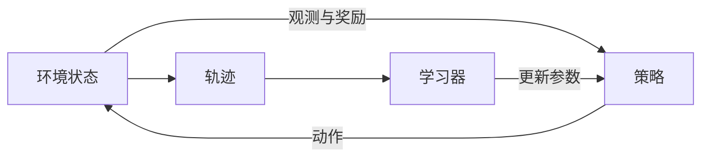

# 第02章 一张图理解强化学习的基本体系

> 读前回顾：[第01章](01-why-rl.md)

让一个智能体走出网格迷宫，看起来只需要反复选择上下左右。但要让它学会走，我们得先说清楚：它能看见什么，走错会怎样，什么时候算完成？

状态、观测、动作、奖励和策略，便是描述这件事的共同语言。先在小迷宫里弄懂它们，后面的大模型与工具任务就有了落脚点。

## 2.1 一次交互包含什么

回到迷宫中的一步：智能体（Agent）看到当前位置，策略 $\pi$ 选择“向右”，环境移动位置并给出奖励。把这些观测、动作、奖励和结束标记记下来，就得到一条轨迹。等积累了经历，学习器再更新策略；每走一步，不一定都要训练一次。

在这个小环境里，可以规定每走一步得−1，到达目标再获得完成奖励并终止。换到其他任务，动作的形式会变化：机器人输出转向角，语言模型输出下一个 token；观测—动作—反馈的关系仍然可以沿用。

## 2.2 状态与观测为什么不同

假如两条走廊外观相同，其中一条前方有障碍，仅凭眼前画面就无法判断下一步。这时，**观测**相同，并不代表**状态**相同。状态应包含预测环境下一步所需的信息，观测则是策略实际能够获得的部分。问数助手看不到全部数据和故障原因，也会遇到类似情况。

马尔可夫决策过程（MDP）假定：给定当前状态与动作，下一步转移和奖励的分布不再依赖更早历史。若相同观测下仍需依赖过去经历判断，就需要部分可观测模型及历史 $h_t$、循环网络或其他记忆机制。增加上下文有助于决策，但不自动使其成为充分状态。

建模时还要确定动作粒度与合法性：撞墙是被屏蔽，还是执行后停在原地并付出成本？规则不同，最优策略就可能不同。

## 2.3 从奖励到累计回报

令 $r_t$ 表示动作 $a_t$ 后获得的奖励，终止时刻为 $T$：

$$G_t=\sum_{k=0}^{T-t-1}\gamma^k r_{t+k}.$$

$\gamma$ 为折扣因子。若奖励依次为−1、−1、10，$\gamma=0.9$，则 $G_0=-1-0.9+8.1=6.2$。单步奖励为负的行为，仍可能通向较高回报。

有限任务可以取 $\gamma=1$；持续任务则需明确采用折扣回报或其他长期目标。调用费、等待和风险等成本应单独建模，不能默认折扣已代表所有成本。

## 2.4 价值、动作价值与优势

| 概念 | 回答的问题 |
| --- | --- |
| $V^\pi(s)$ | 从这里按策略 $\pi$ 继续，平均能获得多少回报？ |
| $Q^\pi(s,a)$ | 先做 $a$，再按 $\pi$ 继续，平均回报是多少？ |
| $A^\pi(s,a)=Q^\pi(s,a)-V^\pi(s)$ | 这个动作比当前策略的通常表现好多少？ |

这些量都与后续策略有关。同一个状态，在强策略与弱策略下可能有不同价值。优势为正表示相对基线更好，并不意味着动作没有成本或一定成功。

贝尔曼关系将长期价值分解为：

$$V^\pi(s)=\mathbb E_{a\sim\pi,\,s'}[r+\gamma V^\pi(s')].$$

期望同时考虑策略的动作选择与环境随机性；自然终止后没有后续价值。这一关系是 TD 和 Critic 学习的基础。[基础概念与定义](https://spinningup.openai.com/en/latest/spinningup/rl_intro.html)

有了这些概念，接下来就可以追问：价值从哪里来，策略又怎样变好？下一章把经典算法放进同一张地图。

## 想一想

某动作的即时奖励为−1、后续价值估计为5，折扣为0.9，一步价值目标是多少？

参考思路

一步价值目标是3.5；它与即时奖励不同，也可能随价值估计更新而改变。

<!-- navigation -->

---

[目录](../README.md) · [上一章：第01章 强化学习解决什么问题](01-why-rl.md) · [下一章：第03章 经典算法的统一地图](03-algorithm-map.md)
