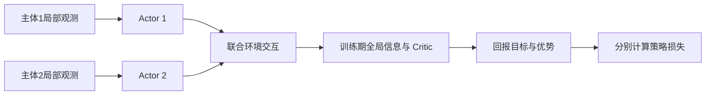

# 第15章 多智能体训练架构与代表算法

> 读前回顾：[第04章](04-policy-gradient-ppo.md) · [第14章](14-multi-agent-modeling.md)

两名智能体各自只看到地图的一角，却要合作抵达目标。训练时，我们能否利用完整地图，帮助它们学会配合；执行时，再让它们各凭局部信息行动？

这就是集中训练、分散执行的基本思路。围绕“训练时谁看见什么、各自怎样更新”，便能理解 MAPPO、QMIX 等方法的差别。

## 15.1 CTDE 的信息边界

训练时有完整地图，并不意味着执行时也必须给每个主体完整地图。CTDE 将两者分开：Critic 可利用训练期的全局状态或联合轨迹帮助估值，Actor 仍依据实际允许的局部信息选择动作。关键是把这条信息边界一直保留到部署时。

Critic 为什么能多看信息？它主要用于训练时评价经历，Actor 执行时不依赖它。完整状态可以帮助 Critic 区分两次外观相近、但真实后果不同的转移，从而提供更有用的优势估计。不过，全局信息过于庞杂也会增加估值难度，并不保证收益。

检查泄漏时，要看实际计算图和输入构造。即使文档把某字段标为“仅训练”，若它经过共享表示进入 Actor，部署条件仍可能被破坏。最直接的测试，是在没有这些字段的执行接口上独立跑完整任务。

## 15.2 代表算法的学习结构

| 方法 | 机制 | 适用切入点与限制 |
| --- | --- | --- |
| IPPO | 各主体使用 PPO 估值与更新 | 简单基线；队友变化仍带来非平稳 |
| MAPPO | 使用集中式价值信息辅助策略更新 | 合作任务强基线；依赖合适的状态与训练配置 |
| VDN / QMIX | 分解团队动作价值 | 离散合作动作；分解结构限制表达能力 |
| MADDPG | 集中 Critic 与分散确定性 Actor | 连续动作；多主体价值学习较复杂 |
| HAPPO | 异构策略及顺序更新 | 不同角色不宜强制共享参数时可考察 |

选择基线可先问：动作是否离散，目标是否合作，执行是否需要分散，角色是否相似。共享奖励的离散控制任务，可以同时考虑 MAPPO 与价值分解；异构连续控制则需要不同参数化。方法表用于缩小候选范围，而非仅凭任务名称给出唯一答案。

IPPO 尤其适合作为起点，因为它能帮助判断集中信息究竟带来了多少增量。若只比较调参充分的复杂算法与未经检查的独立学习，结论可能混入实现质量的差异。

## 15.3 Actor–Critic 与价值分解的取舍

围绕这条边界，可以先看两类方案。[MADDPG](https://arxiv.org/abs/1706.02275)用集中式动作价值评估支持分散连续动作策略；MAPPO 则将 PPO 带入合作任务。

MAPPO 的基本流程是：联合采样→集中 Critic 估计回报→分别构造优势→按各 Actor 可见信息计算概率→执行 PPO 更新。角色可以共享 Actor，但应提供角色标识并屏蔽非法动作。它不等于让每个角色看到所有信息。[MAPPO](https://arxiv.org/abs/2103.01955v4)

[VDN](https://arxiv.org/abs/1706.05296) 将个体价值相加形成团队价值；QMIX 用混合网络将个体价值组成团队价值，并施加对个体价值的单调性约束，使分散贪心动作与所表示团队价值的最大化相容。该结构比简单求和灵活，但不能表达任意联合价值关系。[QMIX](https://arxiv.org/abs/1803.11485v2)

QMIX 的约束可简写为 $\partial Q_{\rm tot}/\partial Q_i\geq0$：其他因素固定时，提高某主体的局部价值，不会降低所表示的团队价值。于是各主体分别选择局部 Q 最大的动作，可以与该表示下的联合贪心选择一致。

这个条件也限制表达能力。假设两人只能选左或右，同选一边得0，不同边得1；某人的“左”是否更好，取决于队友选择。若局部效用只有固定排序，单调混合无法任意表示这种随队友动作翻转的关系。这不表示它不能找到其中一个最优配合，而是说明不能任意还原整个价值表。增加上下文可以帮助区分情境，却不能取消混合结构本身的约束。

Actor–Critic 方法直接优化动作分布，不要求团队价值满足同一种分解形式，但需要估计策略梯度与优势。两类方法的取舍，应围绕表示假设、数据复用与执行需求来判断。

## 15.4 异构角色与参数共享

HAPPO 通过顺序更新处理异构策略的协调；其理论动机与可实现近似应区别理解，不能直接推广为大型语言模型联合训练的无条件改进保证。[HARL](https://www.jmlr.org/papers/v25/23-0488.html)

参数共享减少需要学习的独立权重，主体也能从彼此经历中获得信息，尤其适合同构角色。但共享不意味着输入完全相同：角色标识、可见对象和合法动作仍需编码。否则相同输入可能被要求产生互相矛盾的行为。

异构角色的输出协议、动作空间或目标不同，共享就可能产生冲突。独立参数允许专门化，却增加数据需求。顺序更新的动机，是在协调改动时考虑其他主体已经发生的变化；其实用近似仍需通过具体任务验证。

## 15.5 一次 MAPPO 更新的信息流

例如训练时可用完整地图帮助 Critic 估值，执行时两个 Actor 仍只看局部区域。价值目标提供“这次行动比预期更好还是更差”的信号，并不将完整地图变成 Actor 的执行输入。

参数共享时，将不同主体经验合并更新共享 Actor；独立参数时，将相应经验送到各自 Actor。无论哪种方案，掩码、结束状态、角色样本量和价值输入都应核对。

一条联合轨迹中，每个主体都应有相应观测、动作概率、奖励和有效位置标记。某角色提前结束后，不能把填充动作继续算作真实决策；集中 Critic 则需要与这些时间点一致的全局信息。

例如团队在第五步成功，主体一在第三步已完成自己的子任务。它的早期行为仍可获得团队回报信号，但第三步之后是否继续采动作，应由环境规则决定。掩码与结束语义处理错误，往往会表现为“算法能运行却学不动”，因此必须先核对轨迹。

## 想一想

MAPPO 是否总比 IPPO 好？

参考思路

不能仅凭结构判断；应在同任务、预算与调参条件下比较集中信息是否带来稳定增量。

<!-- navigation -->

---

[目录](../README.md) · [上一章：第14章 多智能体问题建模与协作机制](14-multi-agent-modeling.md) · [下一章：第16章 团队奖励、个体贡献与信用分配](16-team-credit-assignment.md)
